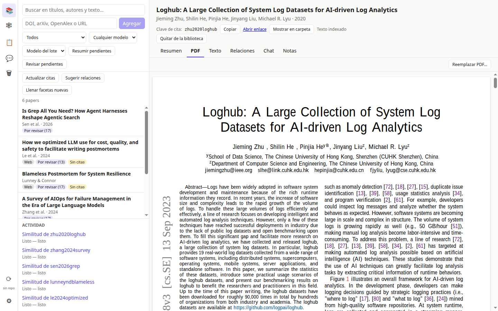
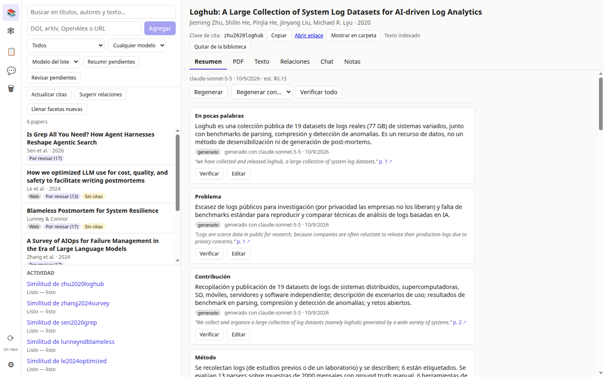
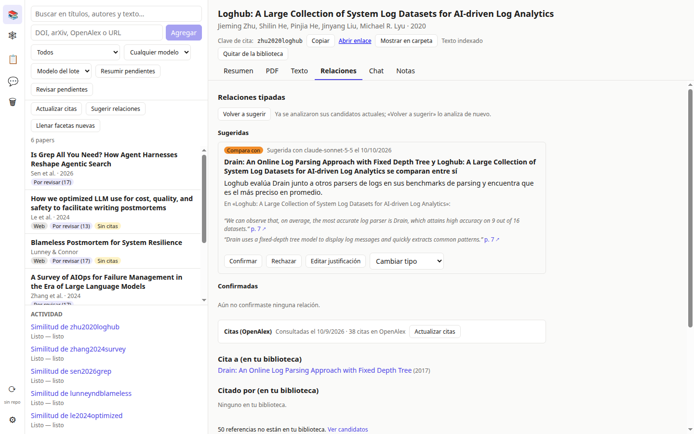
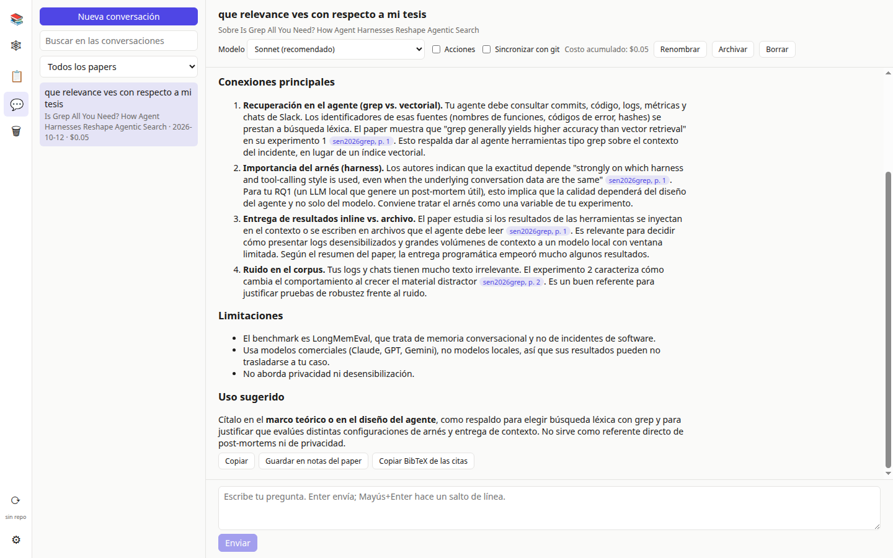
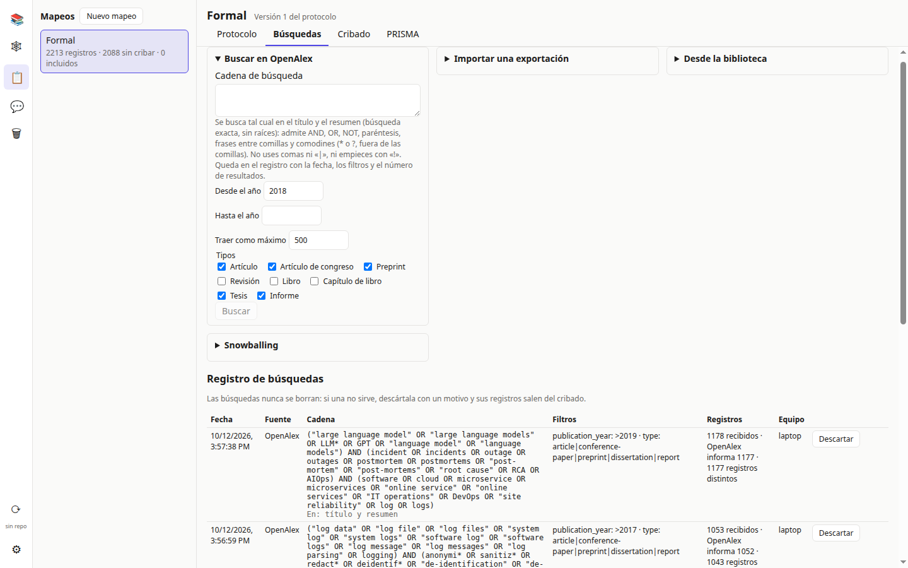
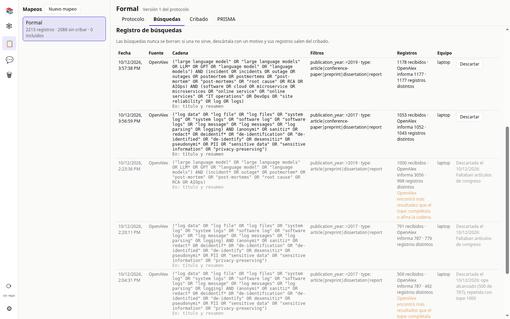
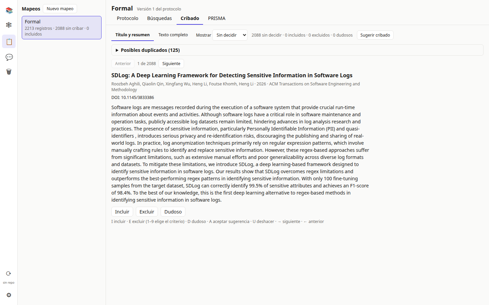
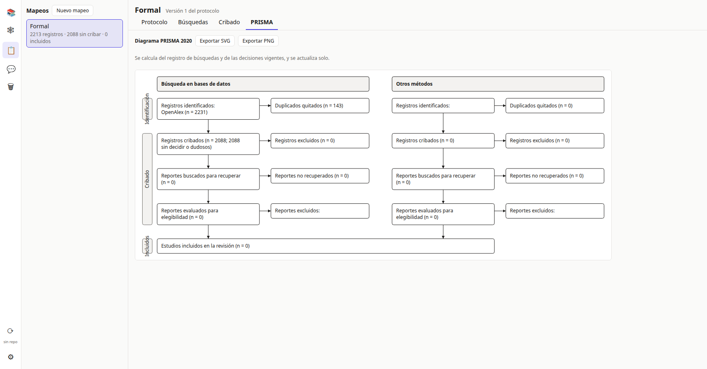
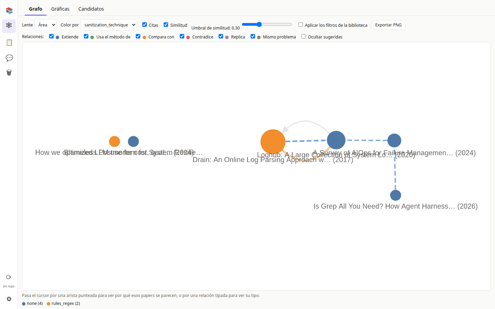
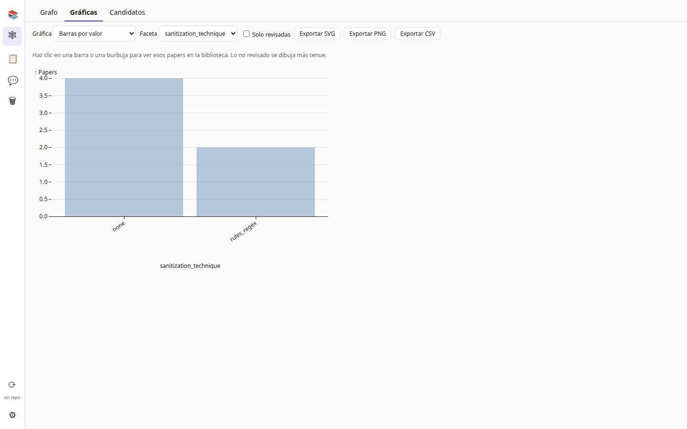

# User guide

*[Versión en español](./guide.es.md)*

This app is a paper library for the thesis *Método computacional para la desensibilización de logs y generación trazable de post-mortems de incidentes de software asistida por modelos de lenguaje locales*. It's a personal, standalone application: it needs no accounts or servers of its own; it uses Claude for the summaries and public services (doi.org/Crossref, OpenAlex, arXiv) for metadata.

## What it's for

- Keep the thesis's papers in a project folder, with their BibTeX, to cite them from LaTeX or org-cite.
- Search titles, authors and the full text of the papers (including grey literature: web pages without a PDF).
- Generate, with Claude, a summary of each paper: its fields (problem, contribution, method, evaluation…), a classification according to the thesis's extraction form, and its relation to the thesis, all with evidence (verbatim quotes with page) and a per-field review status.
- A quick review mode to go through every field and facet Claude generated, one by one.
- Fetch each paper's references from OpenAlex and suggest **citation candidates** (*snowballing*): works your papers cite, or that cite them, which aren't in your library yet.
- Find **similar papers** by combining shared references, shared citers, shared facet values and a local content model, with the reasons for each match.
- See the field in the **Mapa** (Map) view: a graph of papers with two lenses (field and thesis) and per-facet charts.
- Ask Claude for **typed relations** between papers (extends, uses the method of, compares with, contradicts, replicates, same problem), with a justification and quotes from both papers that Claude finds by itself with read-only tools over your library; you confirm, reject or retype them.
- Ask Claude for **suggested facets** for the extraction form: new facets, new values and aliases that merge loose proposed values, with a rationale and quoted examples from your papers. You review them in Settings → Formulario (Form); a new facet is filled in papers already summarized without regenerating their summaries.
- **Chat with Claude** about your library or about one paper: it answers as it writes, searches your papers with read-only tools and cites every claim with the verbatim sentence and its page, which the app checks against the text and which opens the PDF highlighted. Conversations are stored in the project and synced between your machines. If you turn it on in a conversation, Claude can also make changes to the library: what is free and can be undone, when your message asks for it; what costs money, removes or deletes, only with your approval.
- **Sync** the project between your machines with git from the app: it commits your changes, brings in the other machine's, merges them and pushes, never leaving conflict markers in your files; whatever it can't merge on its own, it asks you about.
- Run **systematic mappings** over your library: a protocol with criteria, OpenAlex searches and database imports (all logged), deduplication, two-phase screening with Claude's suggestions that you decide on, and the PRISMA 2020 diagram.
- **Write** with the library in the «Redacción» (Writing) view: a `.bib` with only the entries a chapter cites (following its includes), a check of the citations in a pasted text (unknown keys, papers in the trash or without text, and, with Claude, whether each cited paper supports its sentence), drafts of a section written by Claude from the papers you choose, every citation checked against the paper's text, an outline of the state of the art grouped by facets with its gaps, the outline's wording proposed by Claude with verified citations, and Claude's style suggestions that never touch citations or math, for Org, LaTeX or Markdown.

Coming soon (not implemented yet): a second reviewer and quality assessment for mappings, and mapping reports (tables, charts and exports).

## Getting started

### Install and run

```bash
pnpm install
pnpm dev
```

Requires Node.js 24 or later and pnpm (`corepack enable`).

### The Claude CLI

Summarizing papers needs the `claude` CLI installed on the system and signed in:

```bash
claude login
```

The app invokes it locally, in non-interactive mode and without tools or MCP; it opens no network of its own and sends nothing anywhere except Claude. If the CLI isn't installed or isn't signed in, any attempt to summarize fails with «No se pudo usar Claude: revisa que la CLI `claude` esté instalada y con sesión iniciada.» (Couldn't use Claude: check that the `claude` CLI is installed and signed in.).

### Create or open a project

On startup with no project open, the app asks you to create a new one (a name and a folder that doesn't already hold a project) or open an existing one (a folder that already has `project.yaml`). If you pick a folder that already holds a project to create a new one, it warns «Esa carpeta ya tiene un proyecto; ábrelo en lugar de crear otro.» (That folder already has a project; open it instead of creating another one.). The project stays open for the next time you start the app.

### Syncing the project between machines

The project folder is plain text (YAML, Markdown), meant to be versioned with git. The app syncs with git by itself (see "Syncing with git" below); you can also use git by hand or a tool like Syncthing. Files reload on their own when they change from outside the app (a sync, a `git pull`, an external editor) — no restart needed. If two machines edit the same file at the same time outside the app's sync, the app detects it as a conflict (see "Common problems" below). The trash (`.trash/`) syncs too: a paper you remove on one machine shows up in the other's «Papelera» (Trash), and can be restored or deleted there the same way.

## Adding papers

In the library's top bar you can:

- **Paste a DOI, an arXiv id or a URL** and tap «Agregar» (Add). It also accepts an OpenAlex id (`W2741809807` or `https://openalex.org/W2741809807`); that's what «Agregar» (Add) in Candidates uses for works without a DOI. For a URL that isn't a DOI or arXiv id, the app looks at what's behind it: if it serves a PDF, it's added as a PDF; if the page has a DOI or an arXiv id, that identifier is used; otherwise it's saved as a web page (grey literature), with its readable text if found, and if not, it warns that «La página no tiene un artículo legible.» (The page has no readable article.).
- **Drag one or more PDFs** onto the library.
- **Open a URL in the app's browser** with «Abrir en navegador» (Open in browser), next to «Agregar» (Add); see "Sites that block downloads" below.

The app fills in metadata automatically from the identifier. If the paper ends up with «Los metadatos están incompletos.» (Metadata is incomplete.), you can paste a DOI or arXiv id in the notice and tap «Completar» (Complete), or tap «Reintentar» (Retry) if it already had one.

When a paper is added (or its metadata completed), the app looks up its references in OpenAlex in the background (see "Citations and candidates"); this uses no Claude quota.

Adding an identifier or PDF that's already in the library updates the existing paper instead of duplicating it («ya estaba en la biblioteca» (was already in the library) / «actualizado» (updated) in the activity panel). A PDF dropped on the library is matched by the DOI or arXiv id printed on it, or by its title: when nothing matches, it becomes a new paper, and when the paper already has a PDF, the dropped one is ignored. To give a specific paper its PDF, use its PDF tab instead (see "Attaching or replacing a PDF" below).

### Sites that block downloads

Some sites (many blogs and magazines behind Cloudflare or similar bot protection, pages behind a login, pages built entirely by scripts) refuse the app's downloads. «Agregar» (Add) then fails with «El sitio bloquea las descargas automáticas (HTTP 403)…» (The site blocks automated downloads), never with the OpenAlex API key message, which only appears when OpenAlex itself refuses. The app never tries to get past a site's protection; instead:

- **The app's browser.** In the activity panel, the failed entry has «Abrir en el navegador de la app» (Open in the app's browser); for any URL you can also type it next to «Agregar» (Add) and tap «Abrir en navegador» (Open in browser). A window opens with the page and a toolbar (back, forward, reload, the page's title and address). Browse it as in any browser: if the site shows a check («Verify you are human»), solve it yourself; log in if needed. When the page shows the article, tap «Agregar a la biblioteca» (Add to library). The app reads the page as it is then and makes its PDF (see below): if the page names a DOI or arXiv id, the paper is added through that identifier with the printed PDF; otherwise it's a web page with its readable text (Contenido tab) and the printed PDF (PDF and Texto tabs, search). When no article can be extracted, the paper keeps the page's own title (or one guessed from its URL) with «Los metadatos están incompletos.» (Metadata is incomplete): complete it with «Editar metadatos» (Edit metadata). «Cancelar» (Cancel) closes the window without adding anything.
  **The PDF.** The menu in the toolbar chooses how it's made, and the app remembers your choice:
  - «PDF: vista de lectura (recomendado)» (reader view, the default): a clean document built from the article the app finds in the page, with a header (site, title, authors, date, the page's address and the day you captured it) and the article's text, headings, lists, code, tables, quotes and figures with their captions; serif type, page numbers at the foot. No cookie notices, ads, menus or comments. Its images are fetched through the same browser session (so they load as they did for you) and embedded in the PDF; an image that can't be fetched is left out. Search, «Texto» and the evidence of summaries use this PDF's text, so quotes and pages match what you read.
  - «PDF: página tal como se ve» (the page as it looks): the live page printed, with cookie-consent dialogs (OneTrust, Cookiebot, Didomi, Quantcast, TrustArc, Usercentrics, Sourcepoint, Osano, Termly, Complianz, CookieYes and similar banners, and the dark backdrop behind them) hidden first and scrolling restored. The app only hides them while printing: it never accepts or rejects anything on the site. Ads and menus stay, as on screen.
  When the app finds no article in the page (a login wall, a page built only by scripts), it prints the page as it looks, whichever option is chosen.
  **Cookie notices.** If the site shows a cookie dialog, the toolbar reminds you that the most private answer is to decline the non-essential ones. The reader-view PDF doesn't depend on it: the dialog is never part of the article.
  **«Vista de lectura» (Reader view).** The toolbar button shows, in place of the page, exactly what the reader-view PDF will contain: the same clean document, built the same way (the same header, text and embedded images), so you can check it before adding. «Ver página» (Show page) goes back to the page, which stays as you left it. The reader view follows the page: when it navigates or reloads, it's built again. If the page has no article to read, the page stays and the toolbar says «Esta página no tiene un artículo legible; se guardará la página tal como se ve.» (This page has no readable article; the page will be saved as it looks). With «PDF: página tal como se ve» the button is disabled (that PDF is the page itself). The reader view runs without JavaScript and loads nothing from the web.
  **A page already in the library.** If the page is already in the library (the same address, ignoring `http`/`https`, `www.`, a `#section`, tracking parameters such as `utm_…` and a trailing `/`), the toolbar says so as soon as the page loads: «Ya está en la biblioteca como <clave>» (Already in the library as <key>), and the main button becomes «Actualizar PDF de <clave>» (Update PDF of <key>). It replaces that paper's PDF, as «Reemplazar PDF…» does: the key, metadata, summaries and notes stay, and the new text is indexed. There is no «add as new»: the library keeps one paper per address. (If you press the button before the check finishes and the page turns out to be in the library, the toolbar asks «Esta página ya está en la biblioteca como <clave>. ¿Actualizar su PDF?»; «No» goes back to the page without changing anything.)
  **«Volver a capturar desde la web» (Capture again from the web).** To fix the PDF of a paper you already have (captured with a banner over the text, or a landing page instead of the article), open the paper and use «Volver a capturar desde la web» in its PDF tab (or the Contenido tab of a web page). It's offered for any paper with an address: its URL, or else its DOI (opened at doi.org, which takes you to the publisher). The app's browser opens there, bound to that paper: the toolbar shows «Recaptura: <clave>» (Recapture: <key>), and the main button is «Actualizar PDF de <clave>», which replaces that paper's PDF directly (summaries and notes stay). If you browse to another site than the paper's (its address's, or the publisher's the DOI led to; subdomains count as the same site), the toolbar asks first: «Estás en otra página; ¿actualizar igual el PDF de <clave>?» (You're on another page; update <key>'s PDF anyway?). Opening any other address in the app's browser unbinds the window.
  The window is kept apart from the app: the page runs sandboxed, with no access to your files or to the app, every permission (camera, microphone, notifications, location…) is denied and downloads are blocked (download a file from that site in your own browser). Cookies and logins made there are kept between uses in a session of their own, separate from the app's.
- **Print to PDF in your own browser.** Open the page in your browser, use Ctrl+P → «Save as PDF», and drop the file on the library (a new paper, titled from the PDF) or on a paper's PDF or Contenido tab (see below).

### Editing metadata

«Editar metadatos» (Edit metadata), under the paper's title in its detail, opens a form with the title, the authors (one per line, «Family, Given»; an organization on its own), the year (for a web page, its date as `YYYY`, `YYYY-MM` or `YYYY-MM-DD`, which sets the year), the journal or venue (for a web page, its site) and the URL. «Guardar» (Save) writes `paper.yaml` and the same fields in the paper's BibTeX entry, keeping every other field (pages, volume, publisher…), and updates `exports/library.bib`. The citation key never changes. Right after saving, «Deshacer» (Undo) puts back what the edit changed, as long as `paper.yaml` hasn't changed since. Filling in title, authors and year marks the metadata as complete.

### Attaching or replacing a PDF

To add the PDF of a paper that's already in the library (for example one added by DOI without an open-access PDF), open the paper and, in its **PDF** tab, tap «Adjuntar PDF…» (Attach PDF…) to pick the file, or drop the file on the tab. For a web page without a PDF, the «Adjuntar PDF…» button is at the top of the **Contenido** (Content) tab, which also accepts the dropped file. Only one `.pdf` file at a time is accepted, up to 200 MB. A PDF dropped on an open PDF or Contenido tab is attached to that paper instead of being added as a new paper. An attached PDF is always kept in the paper's folder (`papers/<key>/paper.pdf`, tracked or ignored by git per the PDF policy), even with «No guardarlos: descargarlos al abrirlos» (Don't store them: download on open), since it can't be downloaded again; a previously downloaded copy in `.cache/` is removed.

When the paper already has a PDF, the PDF tab has a «Reemplazar PDF…» (Replace PDF…) button at the top (dropping a file there works too); next to it, «Volver a capturar desde la web» (Capture again from the web) takes a new PDF from the paper's page instead (see "Sites that block downloads"). Before replacing it, the app asks: «Se reemplaza el PDF y se vuelve a extraer el texto. Los resúmenes no cambian.» (The PDF is replaced and its text extracted again. Summaries don't change.).

Attaching runs as a job in the activity panel («Adjuntar PDF a <key>» (Attach PDF to <key>), outcome «PDF adjuntado» (PDF attached)). Only the PDF changes: the paper's metadata isn't looked up or merged again, and the PDF's text replaces the previously indexed text (search, the Texto tab, summaries generated from now on). Existing summaries are kept as they are, so after a replacement their evidence quotes and page numbers may point to a different place in the new PDF; regenerate the summary if that matters. If the file isn't a PDF, it's damaged, or the paper's `paper.yaml` has a problem, the job fails and nothing changes.

Each paper gets a **citation key** (its folder under `papers/`) that never changes, even if you edit its metadata. It can be copied with the «Copiar» (Copy) button next to the key, in the paper's detail.

The app keeps `exports/library.bib` with the BibTeX of every paper, ready to cite from LaTeX or org-cite. It's a generated file: don't edit it by hand.

## Library

The list on the left shows every paper matching the active search and filters.

- **Search**: the box at the top searches titles, authors and each paper's indexed full text.
- **Badges** (under each paper's title):
  - *Error en archivo* (File error): `paper.yaml` couldn't be read (git conflict markers, invalid YAML, or missing fields).
  - *Metadatos incompletos* (Incomplete metadata): title, authors or other data still needs completing.
  - *Web*: the paper is a web page (no PDF, with extracted text).
  - *Sin PDF* (No PDF): not a web paper and has no attached PDF.
  - *Sin resumen* (No summary): not summarized yet (and already has indexed text). A paper too long to summarize without «Forzar» (Force) (see "Summaries with Claude") doesn't show this badge while it has no summary.
  - *Por revisar (N)* (To review (N)): the summary has N fields, facets, or the thesis relation still neither verified nor edited, or a previously reviewed thesis relation that's now pending re-review because the thesis changed. N also counts the suggested typed relations that involve the paper and that you haven't confirmed or rejected yet, so the badge can show even when the summary is already reviewed.
  - *Revisado* (Reviewed): everything generated has already been verified or edited.
  - *Desactualizado* (Stale): the summary went stale because the extraction form changed, or because the thesis changed and the relation to it was still in *generado* (generated) (see "Summaries with Claude").
  - *Resumen falló* (Summary failed): the last summarize attempt ended in an error.
  - *Sin citas* (No citations): the paper wasn't found in OpenAlex (it has no DOI and there was no exact title-and-year match), so it has no citations or candidates.
- **Filters**: by summary status (all, no summary, to review, reviewed, stale, with error, con relaciones por revisar (with relations to review)) and by the model it was generated with (the selector is labeled «Resumido con» (Summarized with) for screen readers; its visible options are «Cualquier modelo» (Any model), Sonnet, Haiku and Opus).
- **Facet filter**: clicking a bar or a bubble in the charts (Map view) opens the library filtered by that value (or a pair of values), shown as a `facet = value` tag you can remove with ✕.
- **«Actualizar citas»** (Update citations): looks up the references of every paper again in OpenAlex or, when a search or any filter is active, only of the visible ones. The jobs show up in the activity panel.
- **Sugerir relaciones** (Suggest relations): asks Claude for typed relations for the papers whose candidates changed since their last analysis (all of them or, with a search or filter active, only the visible ones). Before queueing it shows the number of papers, the estimated cost and the batch cap; if there are none, it says «No hay papers con candidatos nuevos por analizar.» (No papers with new candidates to analyze.). See "Typed relations".
- **Batch actions**: both queue, in one go, every eligible paper visible under the current search and filters (over-long ones are skipped unless they already have a forced summary); both ask for confirmation before queuing. All of a batch's jobs are queued upfront; if the batch cap (or Claude's quota) is hit while it runs, that batch's jobs still queued are cancelled.
  - *Resumir pendientes* (Summarize pending): queues papers with no summary (or a stale or failed one) within the batch budget, using the model chosen in the «Modelo del lote» (Batch model) selector. The confirmation shows the number of papers, the estimated cost and the batch cap; if none are pending, it warns «No hay papers pendientes de resumir.» (There are no papers pending summarization.).
  - *Regenerar filtrados con…* (Regenerate filtered with…): with an active status filter (not «Todos» (All)), regenerates with the model chosen in its own selector every visible paper that has indexed text.
- **Activity panel**: lists running and recent jobs (adding an identifier or PDF, attaching a PDF to a paper, completing metadata, summarizing, citations, who cites a paper, a paper's similarity, downloading the similarity model, sugerir relaciones (suggest relations)), with their status (queued, running, done, failed, cancelled) and, when applicable, the outcome (added, updated, was already in the library, PDF attached, summarized, citations updated, not found in OpenAlex, incoming citations updated, model downloaded, relaciones sugeridas (relations suggested), sin candidatos para analizar (no candidates to analyze)). The model download shows its progress as a percentage. A queued or running job can be cancelled. Tapping a job's name opens its paper.

## Removing papers and the trash

**«Quitar de la biblioteca»** (Remove from library) deletes nothing: it moves the paper's whole folder (`paper.yaml`, PDF, summary, extraction, notes and text) from `papers/<key>/` to `.trash/<key>/`, inside the project, and records when and on which machine in `.trash/<key>/trashed.yaml`.

- **One paper:** in its detail (in the library or the graph), «Quitar de la biblioteca» asks for confirmation with its title.
- **Several:** with a search or any filter active, the list's «Quitar de la biblioteca» button removes every visible paper; the confirmation says how many. Without a search or filter, the button doesn't show.
- Its pending jobs (summary, citations, citing works, similarity, relations and attaching a PDF) are cancelled before it moves.
- For a few seconds «N papers movidos a la papelera» (N papers moved to the trash) shows with **«Deshacer»** (Undo), which restores them.

A paper in the trash disappears from the library, search, graph, charts, similar papers, Review mode and `exports/library.bib`. Its typed relations stay in `relations.yaml`, but they're hidden (in the app and from Claude) until you restore it. Its key stays reserved: a new paper never reuses it.

If another program has one of the paper's files open (say, its PDF in a viewer), the app retries for a moment and, if it's still busy, shows «Otro programa tiene abierto un archivo de ese paper…» (Another program has a file of that paper open…).

### Trash

The **«Papelera»** (Trash) view (🗑 in the side rail) lists removed papers with title, authors, year, the day they were removed and on which machine («este equipo», this machine, or «otro equipo», another machine), with a simple search and checkboxes to pick several.

- **«Restaurar»** (Restore) puts the folder back in `papers/<key>/` exactly as it was, relations included; if its PDF didn't change, its text isn't extracted again.
- If meanwhile **a different paper** took that key, it comes back under the next free one (e.g. `he2017draina`), with its BibTeX and relations adjusted; the notice says which key it got.
- If **the same paper** (same DOI, arXiv id or title) came back to the library, the app warns and offers **«Fusionar»** (Merge) or **«Cancelar»** (Cancel). Merging leaves a single paper, the library's: it joins both notes (the trashed ones at the end), keeps the summary and extraction with more verified or edited entries, takes the trashed files the library lacks, and moves its relations to the library key. No differing copy is lost: the one that doesn't win stays beside the other as `<name>.trashed.<ext>` (from the trash) or `<name>.before-merge.<ext>` (from the library), e.g. `paper.trashed.pdf`.
- If a `papers/<key>/` folder without `paper.yaml` was left behind (by a sync), restoring moves the files into it without overwriting any: a clashing one is kept as `<name>.trashed.<ext>`.
- Anything the app doesn't move (a subfolder, or a file such as `.DS_Store`) stays in the trash and the notice says so («Algo de … sigue en la papelera», Something of … is still in the trash). The paper itself is back in the library as usual, with its relations and jobs; delete the leftover for good when you no longer need it.
- **«Eliminar definitivamente»** (Delete permanently, one or several) and **«Vaciar papelera»** (Empty trash) ask for confirmation with the number of papers and of relations that will be removed from `relations.yaml`, and delete exactly those papers. If `relations.yaml` has a git conflict, nothing is deleted until it's resolved. Deleted papers can only be recovered from git history, and PDFs you keep out of git («Guardarlos fuera de git» or «No guardarlos» policy) can't be recovered.
- A trash folder that can't be restored shows the reason, e.g. «No se puede restaurar: le falta paper.yaml.» (Can't be restored: paper.yaml is missing.); check it in the project's `.trash` folder. «Restaurar (N)» (Restore, for the checked papers) counts and restores only the ones that can be restored.

In **«Candidatos»** (Candidates, Map view), a work that matches a paper in your trash (by OpenAlex id or DOI) shows «En la papelera» (In the trash) with **«Restaurar»** (Restore) instead of «Agregar» (Add).

## Syncing with git

The app syncs the project folder with a git repository: it commits your changes, brings in the other machine's, merges them and pushes the result. It uses the git installed on your machine and its credentials (ssh-agent or git's credential manager): it never asks for or stores passwords. If your SSH key has a passphrase, it must be loaded in ssh-agent (`ssh-add`) before syncing; the app can't type it for you.

- **In the side rail**, above ⚙, the ⟳ button syncs right away (or opens the Sync view if it can't, or if that sync ended in an error or conflicts); under it there's a short status («ahora», now; «3 min»; «sin subir», not pushed; «sin red», offline; «conflictos», conflicts…) and, on hover, the full one: «Sincronizado hace 3 min» (Synced 3 min ago), «Cambios sin subir» (Changes not pushed), «Sin conexión» (Offline), «Conflictos por resolver» (Conflicts to resolve) or «Sincronizando…» (Syncing…). Clicking the status opens the **Sincronización** (Sync) view, with the repository, the branch, the last error and the «Sincronizar» (Sync) button.
- **What gets pushed**: only the files in the project folder (honoring `.gitignore`; `.cache/` never), in a commit «research: sync from <machine>» listing the papers touched. If nothing changed, there's no commit. If the project lives inside a bigger repository (say, your thesis's), whatever you have outside the folder, staged or not, is left alone and stays out of the commit; commits you made yourself with git are pushed with the branch. If you had staged (`git add`) a change inside the project by hand before syncing, the sync's commit includes it anyway: nothing is lost, but it stops showing up as separately "staged".
- **How it merges**: it never rewrites history (merge, not rebase: the other machine's commits stay as they are) and never leaves conflict markers in your files, because it computes the merge apart and only changes files once the result is complete. It merges on its own `relations.yaml` (joined by `id`; if a relation changed on both machines the latest change wins, and one deleted on one machine and untouched on the other stays deleted), `facet-suggestions.yaml` (the same way, by `id`: a suggestion changed on one machine only takes that machine's version, and changed on both, the latest change wins), the `costs/` spend logs (lines joined), the conversations in `chats/` (if one machine only added messages, or renamed or archived the conversation, they merge; if both machines continued the same conversation, both are kept, the other machine's showing as «(copia de <equipo>)» (copy from <machine>)), the drafts in `drafts/` (the same way: a new version or a rename on one machine merges; the same draft changed on both is kept twice, as «(copia de <equipo>)»), `project.yaml` key by key (dismissed candidates are added up), the `trashed.yaml` of a paper removed on both machines (latest date wins) and `exports/library.bib` (the app regenerates it). A file you added that git relocated because the other machine renamed its folder isn't lost or asked about: it's kept beside the original as `<name>.conflict` (or `.conflict-2`, etc. if one already exists).
- **Conflicts**: if a file changed on both machines and the app can't merge it (a `summary.md`, `extraction.yaml`, `paper.yaml` or `notes.md`, or the same key of `project.yaml`), the sync stops without touching your files and the Sync view shows «Conflictos por resolver» (Conflicts to resolve): each file with the paper it belongs to, what each machine did, «Ver diferencias» (Show differences: both versions side by side) and «Quedarme con la mía» (Keep mine) / «Usar la del otro equipo» (Use the other machine's). If one machine moved a paper to the trash while the other edited it, you pick «Conservar el paper» (Keep the paper: it returns to the library with the edits and leaves the trash) or «Aceptar que se quitó» (Accept that it was removed: it stays in the trash, with the edits git could carry there). Nothing gets pushed until you've chosen for all of them («Terminar sincronización» (Finish sync) only enables then); «Cancelar» (Cancel) leaves everything as it was (your changes stay in a local commit, not pushed). If something changes while you're deciding (something new was saved here, or the other machine pushed), the app asks you again before going on. The version you don't pick isn't lost: it stays in git history.
- **Outside the project folder**: if the project lives inside a bigger repository and the other machine changed the same outside files, or if you have a hand-run git merge or rebase left unfinished, the sync stops without touching anything; resolve it with git and sync again.
- **Automatic**: «Sincronizar automáticamente» (Sync automatically; Settings → App, on by default) syncs when the project opens and every 10 minutes (or the interval you choose, 5 to 120) if the repository has a remote. It skips an interval while conflicts wait for your decision or while papers are being moved to or from the trash, and it never opens windows: if it fails (offline, credentials), only the side rail shows it, and it tries again at the next interval.
- **On close**: if the project has uncommitted changes, unpushed commits or pending decisions, the app asks «Sincronizar y cerrar» (Sync and close), «Cerrar sin sincronizar» (Close without syncing) or «Cancelar» (Cancel). The window closes only if that sync succeeds; if it finds conflicts or fails, it stays open and you can go to «Ver sincronización» (Show sync). If an automatic sync was running at that moment, it waits for it and syncs again, so what you saved last is pushed too. While it syncs you can still choose «Cerrar sin sincronizar»: the transfer stops and whatever wasn't pushed stays on your machine for next time.
- **First use**: if the folder isn't in a repository, the Sync view offers «Inicializar repositorio» (Initialize repository: `git init` in the project folder, on branch `main`, with the `.gitignore` the app already maintains) and a field for the URL of an empty remote repository (on GitHub, GitLab or a shared folder); a URL with a password is refused. With a URL, it pushes the project when done. If the repository has no remote, the same URL with «Agregar remoto y sincronizar» (Add remote and sync); if the branch tracks no remote branch, «Conectar y sincronizar» (Connect and sync) connects it to the branch of the same name (or publishes it if there's none). That URL can only be corrected while that remote has never worked (it hasn't yet been used to sync); once it has, changing it needs `git remote set-url origin <url>` by hand. If the remote has a different history from this repository, the app refuses it (see "Common problems" below). For a second machine, clone the repository with git and open that folder as the project.
- **PDFs in git LFS**: with the «Versionarlos con git LFS» (Track them with git LFS) policy, git-lfs must be installed; if it's missing, the sync says so. The app sets up git-lfs in the repository itself and uploads the PDFs before the commits that point to them, so it works even with git hooks turned off (`core.hooksPath`); if the upload fails, nothing is pushed.

## Paper detail



Selecting a paper opens its tabs (only the ones that apply):

They appear in this order: Resumen, Contenido, PDF, Texto, Relaciones, Chat, Notas.

- **Resumen** (Summary): see "Summaries with Claude" below.
- **Contenido** (Content): the extracted readable text, whenever there is one (typically web pages without a PDF), rendered as a readable document (headings, paragraphs, lists, tables, blockquotes, code). Links open in the system browser; images aren't loaded, they show as a small chip linking to the image instead. Following an evidence link to a web paper opens this tab with the quote highlighted and scrolled into view; if the exact text isn't found, it shows a small notice. Selecting text shows «Preguntar a Claude» (Ask Claude; see "Chat with Claude").
- **PDF**: the PDF viewer. Shown for any paper that isn't a web page, even before it has an attached PDF: in that case it shows «Este paper no tiene PDF. Usa «Adjuntar PDF…» o suelta el archivo aquí.» (This paper has no PDF. Use «Adjuntar PDF…» or drop the file here.) instead of the viewer. See "Attaching or replacing a PDF" above. Selecting text shows «Preguntar a Claude» (Ask Claude; see "Chat with Claude").
- **Texto** (Text): the PDF's extracted text, page by page, laid out for reading. Shown when the paper has a PDF and its text is indexed (see "Reading the text" below).
- **Relaciones** (Relations): at the top, the «Relaciones tipadas» (Typed relations) section (see "Typed relations"); below it, the citation status (not fetched yet, fetched on a date with N citations in OpenAlex, or *Sin citas* (No citations)) with an «Actualizar citas» (Update citations) button; «Cita a (en tu biblioteca)» (Cites, in your library) and «Citado por (en tu biblioteca)» (Cited by, in your library), library papers only, each opening on click; how many references aren't in your library, with «Ver candidatos» (See candidates), which opens the Candidates tab filtered by this paper; and «Similares» (Similar): the 10 most similar papers with their score and reasons (e.g. «6 referencias en común · citados juntos por 3 papers · technique: ner · similitud de contenido 0.82» (6 shared references · cited together by 3 papers · technique: ner · content similarity 0.82)).
- **Chat**: the conversations with Claude about this paper, and «Nueva conversación» (New conversation); see "Chat with Claude".
- **Notas** (Notes): your own notes in Markdown, with autosave (`notes.md`). If the file changed from outside the app while there were unsaved changes, it warns of the conflict and lets you choose between reloading (discards your own) or overwriting with your own version.

### Reading the text

The Texto tab shows one page at a time, with «Página N de M» (Page N of M), «Anterior» / «Siguiente» (Previous / Next) and a box to jump to a page. The text is reflowed: words hyphenated at a line end are joined, the lines of a paragraph are merged, short title-like lines (such as «1 Introduction», «2.3 Results» or all-caps lines) show as headings, and running headers, footers and page numbers that repeat across pages are dimmed. The search box searches every page, ignoring case and accents, and shows how many results there are; the arrows move between results, changing page when needed, with each match highlighted.

Above the detail: the citation key (with a button to copy it), the link to the original DOI or URL, «Mostrar en carpeta» (Show in folder) (opens `papers/<key>/` in the file explorer), and the indexed-text status (indexing, text indexed, PDF without text/scanned, no text, extraction error).

## Summaries with Claude



A summary (`summary.md`) has these fields: tl;dr, problem, contribution, method, evaluation, results, limitations (stated and inferred), future work, and research type (solution proposal, validation, evaluation, experience, philosophical, or opinion). Along with the summary, the app generates a classification (`extraction.yaml`) according to the project's form facets, and, if the thesis has a defined topic, that paper's relation to the thesis. If the project doesn't have an extraction form yet, summarizing creates the default form first (see "Form" under Settings) automatically.

Every field, facet and the thesis relation carry:

- **Evidence**: one or more verbatim quotes, with the page number when it applies. Each quote with a page shows a «p. N ↗» link that opens the PDF tab at that page with the quote highlighted (on a web page, it opens the Contenido tab instead, with the quote highlighted there too). If the exact text isn't found, there's no link; the extracted passage around that quote is only shown in Review mode (see below).
- **Status**: *generado* (generated) (just created by Claude, unreviewed), *verificado* (verified) (you confirmed it's correct), *editado* (edited) (you corrected it by hand), or *evidencia no encontrada* (evidence not found) (Claude generated the field with a quote that isn't found in the text: review it carefully). An edited value is already considered yours and doesn't go back to *generado* unless you unverify it from *verificado*.
- **Provenance**: the model and date that particular field was generated with, or the whole summary's if the field has none of its own.

Actions on each field: **Verificar** (Verify) (moves to verified), **Desverificar** (Unverify) (goes back to generated), and **Editar** (Edit) (opens an editor and saves as edited). **Verificar todo** (Verify all) marks everything still *generado* in that paper as verified, in one go.

**Proposed values**: if Claude returns, for a single- or multiple-choice facet, a value that isn't in the allowed list, it's left as "proposed" under that facet. You can **Aceptar** (Accept) it (adds it as an allowed value of the facet) or **Mapear a…** (Map to…) (associates it with an existing value, as an alias). Both actions apply to every paper with that same proposal, not just the one you're viewing.

**Regenerate and model**: «Regenerar» (Regenerate) resummarizes the paper with the configured model; «Regenerar con…» (Regenerate with…) lets you pick the model for that one time without changing the one in Settings. Regenerating never overwrites a field that's already verified or edited — it only updates what was still *generado*.

**Force and truncation**: if the paper's text exceeds the configured maximum input size, the «Resumir» (Summarize) button (when the paper has no summary yet) is disabled and shows «El texto es demasiado largo» (The text is too long), with «Forzar» (Force) next to it to summarize using only the beginning of the text up to that maximum. If the paper already has a summary, «Regenerar» stays enabled: tapping it fails with «El texto supera el tamaño máximo configurado.» (The text exceeds the configured maximum size.), and «Forzar» appears then. A summary already made from truncated text re-forces itself automatically when regenerated (whether on its own or inside a batch), without needing to tap «Forzar» again. The resulting summary is marked «Resumido solo con el comienzo del texto: el paper supera el máximo de caracteres» (Summarized using only the beginning of the text: the paper exceeds the maximum number of characters).

**Stale**: a summary becomes *Desactualizado* (Stale) when the extraction form changes (removing a facet the paper has, or changing its key, type, description, or — on a scale — its minimum or maximum; adding a facet does not make it stale: on that paper the facet shows «Faceta nueva sin llenar» (New facet not filled), see "Facets suggested by Claude" — unless the paper still keeps values of an earlier facet with that same key, removed and then added again, which does make it stale; adding or removing allowed *values* of a facet, or editing aliases, doesn't either) or when the thesis's topic changes (title, description, or research questions; having either the title or the description defined is enough for there to be a relation to the thesis). The next time it's regenerated, everything still in *generado* is regenerated again; what's verified or edited is kept. If the thesis relation was already verified or edited when the thesis changed, the whole summary doesn't become Stale: the thesis relation instead gets marked «La tesis cambió; revisa esta relación» (The thesis changed; review this relation) and the paper moves to «Por revisar» (To review), instead of losing your edit or verification.

**Costs**: every call to Claude logs its estimated cost in USD. Since the account is subscription-based (not billed per use), these numbers are only an estimate of how much quota you're consuming, not an actual charge. A call cut off before it reports its cost (it hit the time limit or you cancelled the job) is logged at the per-paper cap, marked as estimated (`estimated: true`), so it counts toward the batch and monthly caps.

## Review mode

«Revisar pendientes» (Review pending), in the library, opens a sequential run-through of every field, facet and thesis relation still in *generado* status among the visible papers under the active filters, plus previously reviewed thesis relations left pending because the thesis changed (see «La tesis cambió; revisa esta relación» under "Summaries with Claude"); for those, the **Verificar** button reappears.

Keyboard shortcuts (shown on screen as «V verificar · E editar · U desverificar · → siguiente · ← anterior · Esc salir»; ignored while typing in a text field):

- **V**: verify the current item.
- **E**: edit the current item.
- **U**: unverify the current item.
- **→ / ←**: next / previous.
- **Esc**: if an editor is open, it does nothing (close the editor with its own «Cancelar» (Cancel) button); if none is open, exits review mode.

The right-hand panel shows the PDF with the quote highlighted when the paper has one and the quote is found in the text. Otherwise it shows the passage, formatted for reading: for a web page, its content laid out like the **Contenido** tab, with the quote highlighted (or a small notice if the exact text isn't found); if the quote doesn't appear in the PDF, that page's text laid out like the **Texto** tab (headings, paragraphs, running headers and footers dimmed), with the quote marked wherever it can still be located. If the PDF can't be loaded (or there's no content to show), it falls back to the plain extracted text of that page.

The queue also includes suggested typed relations, each one once, next to the first of its two papers in the list. On a relation the shortcuts are «V confirmar · R rechazar · E elegir otro tipo · U deshacer · → siguiente · ← anterior · Esc cerrar la lista o salir»: **V** confirms it, **R** rejects it, **E** opens the list of types (only those the pair doesn't have yet; **Esc** closes it) and **U** undoes the last decision; the card also offers «Invertir dirección» (Reverse direction) for types with a direction. After each decision, «Decisión guardada.» (Decision saved.) shows for a few seconds with «Deshacer» (Undo), which puts the relation back as it was and back in the queue. While that notice shows, **U** undoes that decision even on a summary item; when there is nothing to undo, **U** unverifies as usual. The right-hand panel shows both papers' evidence side by side (the PDF with the quote highlighted or, failing that, the passage, as elsewhere in review mode).

## Citations and candidates

Citations come from [OpenAlex](https://openalex.org), without Claude. For each paper the app finds its OpenAlex work by OpenAlex id, otherwise by DOI and, without a DOI, by exact title and year (only on an unambiguous match; never for web pages). It stores in `paper.yaml` the full list of what the paper cites, in your library or not, and its total citation count in OpenAlex. If nothing is found, the paper gets the *Sin citas* (No citations) badge. When the OpenAlex work found by id has a different DOI than the paper, the paper's DOI wins. Completing or changing a paper's DOI («Completar» (Complete) or «Reintentar» (Retry)) discards the citations of the old work and fetches them again on their own.

OpenAlex limits requests per day. Without a key it's plenty for a few hundred papers; if you hit the limit (in a citations job or while loading the candidates' data), pending citation jobs are cancelled and «Se alcanzó el límite diario de OpenAlex. Reintenta mañana o agrega una clave de API en Ajustes.» (OpenAlex's daily limit was reached. Try again tomorrow or add an API key in Settings.) appears. A free key (Settings → App) raises the budget.

**Candidates** (Map view → «Candidatos») are works not in your library that:

- **«Referencias de tus papers»** (References of your papers): are cited by at least N of your papers.
- **«Trabajos que citan a tus papers»** (Works citing your papers): cite at least N of your papers. To see them, first tap «Buscar quién cita a mis papers» (Find who cites my papers), which asks OpenAlex who cites each paper (one job per paper, in the activity panel). Papers looked up in the last 7 days are skipped, so tapping it again doesn't spend the daily budget twice; after that week it looks them up again.

The table shows title (linking to the DOI or OpenAlex), year, authors, «Citado por tus papers» (Cited by your papers), «Cita a tus papers» (Cites your papers) and «Citas en OpenAlex» (Citations in OpenAlex). **«Agregar»** (Add) ingests it like any DOI (or by OpenAlex id when it has no DOI); **«Descartar»** (Dismiss) stores it in `project.yaml` so it never shows up again (on any machine). Works already in your library (by OpenAlex id or DOI) never show up. A work that is in your trash shows «En la papelera» (In the trash) and comes back with «Restaurar» (Restore); see "Removing papers and the trash".

## Similarity

Each pair of papers gets a score between 0 and 1 that combines:

| Signal | What it measures | Reason shown |
|---|---|---|
| Content | how alike the title, abstract and (when summarized) problem, contribution and method are, according to a local model | «similitud de contenido 0.82» (content similarity 0.82) |
| Bibliographic coupling | shared references | «6 referencias en común» (6 shared references) |
| Facets | shared values in single- or multiple-choice facets | «technique: ner · task: anonymization» |
| Co-citation | library papers that cite both | «citados juntos por 3 papers» (cited together by 3 papers) |
| Direct citation | one cites the other | «zhu2020loghub cita a he2017drain» (zhu2020loghub cites he2017drain) |

The direct-citation reason shows both papers' citation keys. The 10 most similar papers of each paper are kept. Without the local model, the score uses the other signals only. Everything updates on its own when a paper's citations, summary or text change: a single change updates only what involves that paper, and a batch (for example «Actualizar citas» (Update citations) for the whole library) recomputes everything when it ends. If a batch is cancelled partway through, the full recompute is left pending and runs on the next paper change. Changing the extraction form (which changes every paper's facets) also recomputes everything, only if some facet value actually changed.

## Typed relations



Claude can suggest how a paper relates to others in your library:

- **Extiende** (Extends): builds directly on the other one (extends, improves or generalizes it).
- **Usa el método de** (Uses the method of): applies a method, tool, dataset or technique of the other one, without extending it.
- **Compara con** (Compares with): they are compared directly (one is a baseline of the other, or they are evaluated side by side). No direction.
- **Contradice** (Contradicts): reports results or claims that clash with the other one's.
- **Replica** (Replicates): reproduces the other one's study or experiments.
- **Mismo problema** (Same problem): both address the same problem with different approaches, without building on each other. No direction.

**How they are suggested.** For each paper the app picks up to 12 *candidates*: the library papers it cites or that cite it, then the most similar ones (see "Similarity"). Claude gets the paper with its summary (or its abstract), the candidates with a short summary, and the relations already recorded **for that paper** (never the rest of the library's), rejected ones included so they aren't repeated. It then looks for the evidence itself with **read-only** tools over your library: full-text search, search by meaning (if the local model is downloaded), search for literal text inside one paper (ignoring case and accents), reading pages, a paper's data and summary, its citations and its similar papers. It can't write anything or see files outside the project; the tools exist only while that request runs, and it can use them at most 12 times per paper. Every quote it returns is looked up in its paper's text, as with summaries; the ones that can't be found get a wavy underline.

**When.** With «Sugerir relaciones» (Suggest relations) in a paper's Relations tab (it always analyzes the paper, with all its candidates), with the library's «Sugerir relaciones» batch, or automatically, if you turn on «Sugerir relaciones automáticamente» (Suggest relations automatically) under Settings → Claude. The batch and the automatic trigger only analyze a paper when a candidate appeared that its last analysis didn't see, and never look again at a pair already analyzed from the other paper. One paper is analyzed at a time, with the configured model and the same caps as summaries; the cost is logged in `costs/`. A paper that reaches its per-paper cap fails alone and the batch goes on; the batch stops when the Claude quota runs out or the batch or monthly cap is reached. Automatic suggestions of one day count as one batch for the batch cap. When a paper's analysis fails, the automatic trigger leaves it alone for 24 hours (or until the app restarts); the paper's button still works. Tapping «Sugerir relaciones» while that paper already waits in the queue for a batch or automatic analysis turns that job into yours (all candidates, out of the batch); if one is already running, yours is queued after it.

**Reviewing them.** In each paper's Relations tab, the «Relaciones tipadas» (Typed relations) section shows:

- «Sugeridas» (Suggested), with «Confirmar» (Confirm), «Rechazar» (Reject), «Cambiar tipo» (Change type; it only offers types the pair doesn't have yet), «Invertir dirección» (Reverse direction, for types with a direction) and «Editar justificación» (Edit justification). Quotes from this paper carry their page and open the PDF with the quote highlighted; next to the other paper's quotes, «Abrir» (Open) opens that paper.
- «Confirmadas» (Confirmed): they can go back to suggested («Devolver a sugerida»), be rejected or retyped.
- «Rechazadas (N)» (Rejected (N)), folded: rejecting never deletes; «Restaurar» (Restore) puts it back among the suggested ones and «Confirmar» confirms it.

Changing the type or reversing the direction leaves the relation confirmed and marked *editada* (edited); no previous type is ever suggested again. Editing the justification marks it edited without changing its status. After each decision «Deshacer» (Undo) shows for a few seconds. Analyzing a paper again only replaces the unreviewed suggestions an earlier analysis of that same paper made with the candidates it looks at this time (Claude may repeat them if still supported); those for a pair it skips this time, because it was already analyzed from the other paper, are kept; those suggested by the other paper's analysis, and confirmed, rejected and edited ones, are left alone.

**`relations.yaml`.** All relations live in one file at the project root, sorted by `id` (both keys in alphabetical order plus the type, e.g. `he2017drain__zhu2020loghub__extends`), with their status (`suggested`, `confirmed` or `rejected`), the justification, the quotes with their page and whether they were found, and the model, date and paper whose analysis suggested them; plus, under `analyzed`, which candidates each paper was last analyzed with (so a rebuilt index never spends again on what was already analyzed). It is meant to be versioned with git. If a `git pull` leaves conflict markers in it, the app doesn't modify it and shows, in a notice at the bottom of the window, «relations.yaml tiene marcadores de conflicto de git: la app no lo modifica hasta que se resuelva.» (relations.yaml has git conflict markers: the app won't modify it until it's resolved.) with «Resolver automáticamente» (Resolve automatically: it merges both versions by `id`; if the same relation changed on both sides, the most recent change wins; it keeps keys it doesn't know and reports any invalid entries it had to drop) and «Mostrar archivo» (Show file). If the file can't be read for another reason, «relations.yaml no se puede leer: …» (relations.yaml can't be read: …) shows and it has to be fixed by hand.

## Facets suggested by Claude

Claude can propose how to improve the extraction form from your thesis (title, description and research questions), the current form and what is in the library: an inventory of the papers, how each facet is used, and the «propuestos» (proposed) values the summaries left unassigned. To check what it proposes it reads the library with read-only tools (the typed relations' ones, plus listing the papers, reading one paper's summary and facets, and seeing how each facet is used); it never writes anything.

It suggests three things:

- **New facet**: key, type, description and values (or minimum and maximum, on a scale), with a rationale of how it serves your research questions and quoted examples from your papers.
- **New value** for a single- or multiple-choice facet, typically one several papers proposed.
- **Alias**: merges proposed values that mean the same into an existing or new value.

**Suggesting.** In Settings → Formulario (Form), the «Sugerencias de Claude» (Claude's suggestions) section has the «Sugerir facetas» (Suggest facets) button; before queuing it shows how many papers it will look at, the estimated cost and the run's cap. It runs as a job in Actividad (Activity), one at a time. Each new run replaces only the suggestions still waiting for review: accepted and rejected ones are kept, and Claude sees the rejected ones so it doesn't repeat them. It can also run on its own with «Sugerir facetas automáticamente» (Suggest facets automatically; see "Claude" under Settings).

**Reviewing.** Each suggestion shows its kind, the proposal, the rationale and the examples; clicking a quote opens the passage with the quote highlighted (in the PDF, if the paper has one). A quote not found in the text is marked «cita no encontrada en el texto» (quote not found in the text). The buttons:

- «Aceptar» (Accept): applies the suggestion to the form. A new facet is added and the section offers to fill it in the papers already summarized, with the estimated cost; a new value is added to its facet; an alias is added (with its target value, if new). In papers whose facet is still *generado* (generated), the new value or the alias replaces that proposed value; anything verified or edited is left alone.
- «Editar y aceptar» (Edit and accept): opens the proposal in the same card (key, type, description, values or range; the value; or the value the aliases merge into), with the form editor's rules, and accepts it with your changes («Guardar y aceptar», Save and accept).
- «Rechazar» (Reject): folds it under «N rechazadas» (N rejected), where «Restaurar» (Restore) brings it back for review.
- «Deshacer» (Undo) shows for a few seconds after each decision. Undoing an acceptance puts the form and the papers it changed back as they were, as long as nothing changed since.

While the form editor has unsaved changes, nothing can be accepted or edited and accepted («Guarda o descarta los cambios del formulario antes de aceptar sugerencias.», Save or discard the form's changes before accepting suggestions). If the form changed since the suggestion (say, you already added that facet, or no paper proposes those values any more), the suggestion says why it no longer applies and can only be rejected. Accepted ones are folded under «N aceptadas» (N accepted). The tab reads «Formulario (N)» and the section «N sugerencias por revisar» (N suggestions to review).

**Filling new facets.** Adding a facet (by accepting a suggestion or by hand in the editor) doesn't make summaries stale: papers already summarized show «Faceta nueva sin llenar» (New facet not filled; in the list and in the Resumen tab, with «Facetas nuevas sin llenar: …») and are filled by a cheap job per paper that asks Claude for the new facets only, with evidence, without regenerating the summary or touching anything verified or edited. Filled values are *generado* (generated), to be reviewed like the rest. Filling is offered right after accepting a new facet, with «Llenar en N papers» (Fill in N papers); from the paper, with «Llenar facetas nuevas (~$x)» (Fill new facets), which opens a confirmation with the estimated cost and the batch cap before queuing; or in a batch with the library's «Llenar facetas nuevas» (every paper with an up-to-date summary that needs it, or only the visible ones when a search or filter is active; the «Con facetas sin llenar» (With unfilled facets) filter shows them), always asking to confirm with the estimated cost and the batch cap. It uses the same text as the summary: a paper summarized from the beginning of its text only is filled from that same beginning. A paper with a stale summary is not filled (regenerating it brings every facet), and papers you summarize later get the new facets with their summary.

**`facet-suggestions.yaml`.** Suggestions live in one file at the project root, sorted by `id` (the kind plus what it changes, e.g. `new_facet__data_source`), with their status (`suggested`, `accepted` or `rejected`), the rationale, the examples and the last run. It is versioned with the project, and the app's sync merges it on its own.

**Costs.** Each run is logged in `costs/` as `suggest_facets` (with no paper) and each fill as `fill_facets`.

## Chat with Claude



You can talk with Claude about your library in two places:

- **The Chat view** (💬 in the side rail): all your conversations, newest first, with a search box (it searches titles and messages, ignoring case and accents), a paper filter and the archived ones folded at the end («N archivadas», N archived). «Nueva conversación» (New conversation) starts one about the whole library.
- **A paper's Chat tab**: the conversations about that paper, and «Nueva conversación». Claude gets the paper's metadata and summary, and can still search the rest of the library.

**How it answers.** Every message you send (Enter sends; Shift+Enter adds a line break) goes to Claude with your thesis, the paper (in its tab) and the conversation so far: the latest messages in full and one line per older message. Claude searches your library with the same read-only tools it uses for typed relations (full-text search, search by meaning, finding a sentence in a paper, reading pages, reading the summary, citations and similar papers), at most 12 times per answer and for at most 10 minutes, and, unless you turn on the conversation's actions, never writes anything (see "Actions from the chat"). What the tools return is passed to it as data, never as instructions. The answer shows up as it's written; meanwhile the message box is disabled and «Detener» (Stop) cuts it short: what it had written is kept as a «respuesta detenida» (stopped answer).

**Verified citations.** Claude must back every claim about a paper with a citation: the key, the page and the sentence copied verbatim. The app checks each sentence against the paper's text, with the same tolerance as the summaries' evidence, and shows it as a chip «clave, p. N» (key, p. N). If it isn't found, the chip says «no encontrada» (not found); if the paper is in the trash, «paper en la papelera» (paper in the trash); if it can't tell which paper it refers to, «paper desconocido» (unknown paper). Under the answer, it says how many citations couldn't be verified. Clicking a chip opens the paper's PDF (or web content) on the right at that page, with the sentence highlighted; if it can't be highlighted, the page's text is shown.

**Under each answer** you see its model and cost, and three buttons; none writes anything without your click:

- «Copiar» (Copy): the answer in Markdown, with its citations as text (`"sentence" [key, p. N]`).
- «Guardar en notas del paper» (Save to the paper's notes): appends it to the end of `notes.md`, under a heading with the date and the conversation's title. In a paper's tab it goes to that paper; in the Chat view you pick the paper (cited ones first).
- «Copiar BibTeX de las citas» (Copy the citations' BibTeX): the BibTeX entries of the cited papers in your library.

**Asking about a selection.** Selecting text in the PDF tab or in Contenido shows «Preguntar a Claude» (Ask Claude): it opens the paper's Chat tab with that excerpt and its page above the message box (remove it with «Quitar fragmento», Remove excerpt), and it's sent, quoted, with your next question. The Texto tab doesn't offer it. A longer selection is cut at 1000 characters. If the selection can't be quoted as is (too short), the button turns into a hint instead: «Esta selección no se puede citar: selecciona un poco más de texto.» (This selection can't be quoted: select a bit more text.).

**The conversation header** has the model selector (a new conversation starts with the model in Settings → Claude; changing it applies to the next answers), the running cost, «Renombrar» (Rename), «Archivar» / «Desarchivar» (Archive / Unarchive) and «Borrar» (Delete; it asks first, and git history keeps the file). The title comes from the first question.

**Errors.** If Claude is unavailable, the quota ran out, a cap was reached or it took too long, the notice shows in the conversation with «Reintentar» (Retry). Your question stays saved without an answer (even if you close the app) and «Reintentar» sends it again. If the monthly cap doesn't allow it, the message isn't sent and its text stays in the box.

**Spending.** Each answer has its own cap, «Tope por mensaje de chat (USD est.)» (Per chat message cap (est. USD); 0.5 by default, in Settings → Claude), and counts toward the monthly cap. A stopped answer, or one that took too long, is counted at its cap as an estimate.

**Where they're stored.** Each conversation is a `chats/<id>.md` file, readable Markdown you can edit by hand: its data at the top (title, paper, model, dates, whether it's archived, and the cost), then the messages under `## Tú — <date>` and `## Claude — <date> · <model> · <cost>` headings, with citations written as `[[key|p. N|"sentence"]]`. Actions sit between the messages under `## Acción — <date> · <tool> · <state> · <id>`, with a YAML block of what was asked and what happened. Anything you write before the first heading is lost the next time the app writes the file. They're versioned and synced with git (see "How it merges" in "Syncing with git"). If you move a paper to the trash, its conversations are kept and their header says the paper is in the trash.

## Actions from the chat

Every conversation starts out only reading your library. Its header has two switches, off by default, saved with the conversation (and synced with it):

- **«Acciones»** (Actions): from this conversation Claude can add papers (DOI, arXiv or URL), attach a PDF, write notes, confirm, reject, send back to suggested, retype or reverse typed relations, verify or edit a summary's fields and facets, accept or merge proposed values, accept, reject or restore facet suggestions, start summaries, relation and facet suggestions and filling new facets, move papers to the trash, restore them and delete them for good.
- **«Sincronizar con git»** (Sync with git): Claude can see the sync's state and its conflicts (free) and, if you let it, sync now or resolve conflicts (always asked first). It doesn't need «Acciones».

**Who decides.** The app enforces the rule, not Claude:

- **Without asking**, it only does what's free and can be undone — a note, a review decision (verify, unverify), confirming or rejecting a relation, accepting or rejecting a facet suggestion, adding a paper (unless «Resumir automáticamente al agregar» is on) or restoring from the trash — and only when the action carries words from **your latest message**: each action quotes a phrase of yours, and the app checks it's there, as typed (ignoring case, accents and spacing, with at least a few letters or digits; a bare «sí» isn't enough), in the message that answer started from. It does at most 3 of these per message without asking; from the 4th on, it asks too. Adding a paper without asking also needs its identifier (the DOI, arXiv id or link) to be in your latest message, as you typed it (a DOI's case and a trailing slash don't matter); a link or id Claude found elsewhere, say in a paper, always asks. Editing a summary value and resolving a proposed value **always** ask, even when you quote your own words: they change something you already reviewed.
- **It always asks** for what costs money (summaries, relation and facet suggestions, filling facets, and adding a paper while «Resumir automáticamente al agregar» is on), what removes or deletes (trash, delete for good), attaching a PDF and syncing with git (sync now, resolve conflicts). Reading the sync's state is free.

The app checks only that the words Claude quotes are somewhere in your latest message; they don't have to be about that action. Any phrase of yours of a few words can unlock up to 3 free, undoable actions for that message, even ones unrelated to what you asked, so text Claude reads — a paper, a tool result, an earlier answer — could steer it into them without you asking. The phrase can also sit inside a negation («no agregues una nota a Drain» contains «agregues una nota a Drain») or a question. Adding a paper is the exception: unasked, it also needs its identifier in your message, because it fetches what that identifier points to. That's why there's a cap of 3 per message, why editing a summary or resolving a proposed value always ask, and why every unasked action can still be undone.

**The question** shows up inside the conversation: what will be done, your words (when it used them), why it asks, the papers with their titles and, if it costs money, the estimated cost, the per-call cap, the batch cap and what you've spent this month; when deleting for good, how many relations go too; when resolving conflicts, which version of each file stays. You answer «Aprobar» (Approve) or «Rechazar» (Reject). To attach a PDF the button is «Elegir PDF y adjuntar» (Pick PDF and attach): you pick the file in the app's dialog; Claude never names a path on your computer. If you don't answer within 5 minutes, the action is cancelled. «Detener» (Stop), closing the project, or turning off the matching switch reject whatever is waiting.

**What stays in the conversation.** Every action done, rejected or failed shows among the messages with what was done and why it was allowed («lo pediste», you asked for it, with your words, or «lo aprobaste», you approved it). Those that can be undone show «Deshacer» (Undo): a note is removed if you didn't change it afterwards; relation, summary, proposed-value and suggestion decisions are undone like «Deshacer» in Review and Settings (if nothing changed since); an added or restored paper goes back to the trash, and a trashed one back to the library. «Deshacer» lasts while the project stays open in the app, for that conversation. Attaching a PDF, deleting for good and syncing with git have no «Deshacer»; paid jobs (summarize, suggest relations or facets, fill facets) are cancelled from Activity, not from the conversation.

**The same rules as the buttons.** Actions use the same services as the interface: the same spending caps, validations and lock during a sync. Jobs started from the chat show in Activity, run as one batch (with its cap) and count toward the monthly cap like any other; the cost of Claude's answer is still bounded by its per-message cap. Relation suggestions asked from the chat run even if the paper was already analyzed, like the paper's own button.

**Limits.** Claude can use the actions at most 20 times per answer (on top of its 12 read-only queries). From the chat you still can't set up the sync (repository and remote), edit a facet suggestion before accepting it, merge a restored paper with its twin, or change metadata, citations or form fields: that's done in the interface. If an answer fails after doing some actions, «Reintentar» (Retry) tells Claude which ones already ran so it doesn't repeat them.

**In the file.** Each action is kept in `chats/<id>.md` as `## Acción — <date> · <tool> · ejecutada|rechazada|fallida · <id>` (done, rejected, failed) followed by a YAML block with `approval` (`request` if you asked for it, `user` if you approved it), `request` (your words, or none if you approved it), `args` and `result`. An undo adds another action, `undo`, naming the one it took back. The path of an attached PDF isn't stored.

## Systematic mapping

The **«Mapeos»** (Mappings) view (📋 in the side rail) holds the project's systematic mappings. You can have several over the same library: excluding a study from a mapping never removes it from the library, and a paper already there is never analyzed twice. «Nuevo mapeo» (New mapping) asks for a title; each mapping has four tabs.

**«Protocolo»** (Protocol). Title, objective, research questions («Copiar las preguntas de la tesis», copy the thesis questions, adds the ones from Settings → Thesis that are missing), inclusion and exclusion criteria, and the accepted years and publication types. Each criterion gets a stable id (`I1`, `E2`) that is never reused, even after you remove it. Screening has two phases: title and abstract first, then full text. Until you have decided anything or asked Claude for suggestions, «Guardar protocolo» (Save protocol) just changes it (it stays version 1); afterwards, every change to the body creates a new version (the previous one stays under «Versiones anteriores», earlier versions, with the date it was replaced) and decisions and suggestions made with an earlier version are marked «Tomada con la versión N del protocolo» (made with protocol version N), in the wording the criterion had then, even if it has since been reworded or removed. So if reading the suggestions makes you fix a criterion, the earlier suggestions are marked and «Sugerir cribado» (Suggest screening) offers those records again.

**«Búsquedas»** (Searches). Four ways to bring records in, all kept in the **search log**:

- **«Buscar en OpenAlex»** (Search OpenAlex): you type the string and pick the years and types (they start from the protocol) and the cap on results (500 by default, up to 5000). When you tap «Buscar» (Search), the app first asks OpenAlex how many results the search has (one request with the same string and filters; free, no Claude) while the button reads «Consultando el total en OpenAlex…» (Asking OpenAlex for the total…); «Cancelar» (Cancel) stops waiting for it. The confirmation then says «OpenAlex tiene N resultados; se traerán M» (OpenAlex has N results; M will be fetched) and that it costs nothing (it uses OpenAlex's daily quota); it runs only if you confirm. When N is above your cap and at most 5000, «Subir el tope a N» (Raise the cap to N) sets the cap and keeps the confirmation open; above 5000 it warns that no search brings that many and suggests refining the string. If the count fails (no network, OpenAlex refuses), the confirmation says «No se pudo consultar el total» (The total could not be read) with the reason, and you can still search. Any change to the form drops the count and the confirmation. It searches the title and abstract of each work with OpenAlex's exact (unstemmed) search, so the string takes AND, OR, NOT, parentheses, quoted phrases and wildcards (`anonymi*`); it can't contain commas or `|`, which OpenAlex uses to separate filters (use OR instead), nor start with `!`, which OpenAlex reads as negating the whole filter (use NOT inside the string). Wildcards (`*`, `?`) don't work inside a quoted phrase: the form names the phrase (for instance `"log file*"`) and won't search until you write each form apart (`"log file" OR "log files"`). The log keeps the exact string, the field searched (title and abstract), the filters, the request (without your contact email or API key), the date, how many results it fetched and how many OpenAlex says there are in total, with a warning when the cap left results out.
- **«Importar una exportación»** (Import an export): you pick the file in the app's own dialog (as with attaching a PDF: the app only gets the path you chose there), the database (Scopus, IEEE Xplore, ACM Digital Library, Web of Science or another name you type) and the string you used there. The format is detected from the extension or the content: BibTeX, RIS or CSV (at most 20 MB). The app tells you how many records it read, how many were new, how many it already had, how many are possible duplicates, how many are already in your library, and how many it skipped for lacking a title; if the file had more entries than one file can hold, it warns that only the first ones were imported: split the export into smaller files (by year range, for instance) and import the ones left. Picking the same file again doesn't help, since it reads the same first entries again.
- **«Desde la biblioteca»** (From the library): you tick papers of your library and they come in as records linked to them; it costs nothing and needs no confirmation.
- **Snowballing**: from the studies included on full text that are papers of your library, backward (their OpenAlex references), forward (the works citing them) or both, capped at 2000 works per iteration. It costs no money; it runs only if you confirm. Each iteration is logged with its number (how many snowball searches this mapping already had, plus one) and the records it started from.



**The log's figures.** Each search shows up to three figures, for example «791 recibidos · OpenAlex informa 787 · 782 registros distintos» (791 received · OpenAlex reports 787 · 782 distinct records): the rows that arrived («leídos», read, for an import or the library), the total OpenAlex reported (OpenAlex searches only; for snowballing, the works found), and the distinct records the mapping holds from that search now. They can differ: OpenAlex's total is approximate, and paging through the results can repeat a work, which joins the record already there; records later merged with «Es el mismo» stop counting too. Hovering the figures explains this.

**«Completar búsqueda»** (Complete search): an OpenAlex search the cap cut short has this button. After a short confirmation, it runs the same string with the same filters and field again, with the cap at 5000. When that search finishes and brings back every record the old one had, it replaces it: the old one is discarded and shows «Completada con la búsqueda del <fecha>» (Completed by the search of <date>), the records you already had keep their decisions (they just gain the new search as a source), and PRISMA counts the new search only. If some of the old search's records didn't come back (OpenAlex's index changed in between), discarding it would take them out of the screening, so both searches stay live: Activity says how many records didn't come back and how many of them had decisions, and the old search shows that it was already completed and is no longer offered for completion. If the new search fails, the old one stays as it was. While a completion is queued or running, the button waits. When OpenAlex reported more than 5000 results, the button is disabled: refine the string instead.

Searches are never deleted: «Descartar» (Discard) asks for a reason and marks the search as discarded; it never disappears from the log, but the records only it brought leave the screening and the PRISMA diagram. If `searches.yaml` is edited by hand and left with a count lower than the records that really name it as a source, the search flags this in the log and the PRISMA diagram warns that its counts don't add up.



**Records and deduplication.** Results are not papers: they are light records (title, authors, year, venue, abstract, DOI, arXiv or OpenAlex id). On entry, a record joins an existing one on its own only when they share an identifier with none of the others in conflict (for instance, the same DOI, even given as a URL); with no identifier in conflict, it also joins on its own when the normalized title is equal, the year is equal and known, and both have authors with the same first author's family name (or, with no authors on either side, when title, year, venue and first author match exactly, or neither has authors at all: an exact re-import). Outside those cases the app never joins two records on its own: it asks you. They show as **possible duplicates** («Posibles duplicados») in «Cribado»: identifiers that conflict with each other (a preprint and its published version), the same title and year without the first author matching or without authors on one side, or near-identical titles (word similarity of at least 0.9) a year apart at most. «Es el mismo» (it's the same) keeps the record that was already there and adds the sources and missing fields of the one just flagged (and its screening decisions, when the kept record doesn't already have the same one); «Son distintos» (they're different) keeps them apart for good, on both sides of the pair. Until you answer, the newly arrived record of the pair stays out of the screening queue and the PRISMA diagram. A pair the sync joined because two machines gave different ids to the same identifier shows with the reason «Mismo identificador (llegó por la sincronización)» (same identifier, arrived through sync). A record that already is a paper of your library is linked to it.

**«Cribado»** (Screening). Pick the phase and the list («Sin decidir», undecided; «Dudosos», uncertain; «Incluidos»; «Excluidos»; «No conseguidos», not retrieved; «En conflicto», in conflict; «Todos», all) and decide record by record: «Incluir» (include), «Excluir» (exclude, choosing the exclusion criterion), «Dudoso» (uncertain) and, on full text, «No se pudo conseguir» (could not be retrieved). Shortcuts (ignored while typing in a field): `I` include, `E` exclude (with several criteria it opens the list and `1`–`9` picks one), `D` uncertain, `N` not retrieved (full text), `A` accept Claude's suggestion, `U` undo, `→`/`←` next and previous, `Esc` closes the criteria list. After each decision «Deshacer» (Undo) shows for a few seconds; undoing adds a new decision that goes back to the previous one (nothing is deleted). Each decision keeps the phase, who decided (`main` at this stage), whether it was yours or you accepted a suggestion, the criterion, the date, the machine and the protocol version it was made with.

- **«Sugerir cribado»** (Suggest screening): for the undecided records Claude proposes include, exclude or uncertain, with the criterion, a justification and a quote the app looks for in the title and abstract (or, on full text, in the paper's text) and flags when it isn't there. Before it runs you see how many records and calls it takes, the estimated cost, the per-call cap, the batch cap and what you've spent this month; it runs only if you confirm. On title and abstract it makes one call per 20 records; on full text it makes one call per record, with the library's read-only tools. **The decision is always yours:** Claude only suggests, it never decides, and «Aceptar sugerencia» (accept suggestion) takes exactly what Claude proposed (decision and criterion). It doesn't suggest again for a record that already has a suggestion made with the current protocol version. Its cost counts toward the spending caps as `screening`.
- **Adding to the library**: records included on title and abstract move to the full-text phase. Those that are not yet a paper of your library offer «Agregar N a la biblioteca» (add N to the library, all) or «Agregar a la biblioteca» (one), and ask for your confirmation before running; if «Resumir automáticamente al agregar» is on, the confirmation says what the summaries will cost. They are added with the usual ingest (metadata, BibTeX and the open-access PDF when there is one); next to the record you see the paper's detail, with its PDF and «Adjuntar PDF» (attach PDF) if it's missing, or you mark «No se pudo conseguir» if you won't get it.
- **Conflicts**: if you decided the same record differently on two machines before syncing, it shows under «Decisiones distintas en dos equipos» (different decisions on two machines) with each option, its machine and date; «Quedarme con esta» (keep this one) makes it the current one.



**«PRISMA».** The PRISMA 2020 flow diagram is computed from the search log and the current decisions and updates itself: records identified per source, duplicates removed, screened and excluded on title and abstract, sought for retrieval and not retrieved, assessed and excluded per criterion, and included. Database searches (OpenAlex and imports) go in one column; snowballing and papers taken from the library go under «Otros métodos» (other methods); records still undecided (or marked «Dudoso», uncertain, or in conflict between two machines) are noted in each box as «sin decidir o dudosos» (undecided or uncertain), and a discarded search stops counting. «Exportar SVG» and «Exportar PNG» save it wherever you choose with the usual save dialog.



**In the files.** Each mapping lives in `mappings/<id>/`: `protocol.yaml` (the protocol and its versions), `searches.yaml` (the search log, only ever added to), `records.yaml` (the records with their sources), `decisions.yaml` (the decisions, only ever added to) and `suggestions.yaml` (Claude's suggestions, only ever added to). They sync with git, and the app merges on its own what it can: a search, decision or suggestion added on one machine is never lost, and a record changed on only one machine is kept as is. When the **protocol** is edited on both machines at once and the two edits change its body differently, the app can't merge them on its own: `protocol.yaml` shows up as one of the conflicted files under «Sincronización», where you choose which version stays, the same as with any other file it can't merge; the version you don't pick isn't lost, it stays in git's history. If a mapping's file can't be read (for instance, with conflict markers added by hand), the mapping's list says so until it's fixed.

## Map

The **Mapa** (Map) view (side rail) has three tabs:

- **Grafo** (Graph): one node per paper (larger the more citations it has in OpenAlex) and two kinds of edges: citations (solid arrow) and similarity (dashed, thicker the more alike). Hover a dashed edge to see its reasons; click a node to open its detail on the side. Controls: **«Lente»** (Lens) «Área» (Field; colored by the facet you pick; a paper with several values takes the one most frequent in the library) or «Tesis» (Thesis; colored by the 1–5 relevance of the thesis relation, gray without one); show or hide citations and similarity; «Umbral de similitud» (Similarity threshold); «Aplicar los filtros de la biblioteca» (Apply the library's filters; uses the papers visible the last time you opened the library); «Exportar PNG» (Export PNG; the graph exports to PNG only). Typed relations are drawn with one color per type: solid when confirmed, dotted when suggested, with an arrow except for the types without direction. The «Relaciones:» (Relations:) row has one switch per type and «Ocultar sugeridas» (Hide suggested); hovering a relation shows its type.
- **Gráficas** (Charts): «Barras por valor» (Bars per value), «Burbujas faceta × faceta» (Facet × facet bubbles; empty cells show as gaps) and «Papers por año» (Papers per year). With «Solo revisadas» (Reviewed only) off, every facet value counts and unreviewed ones are drawn fainter; on, only verified or edited ones. Entries that no longer fit their facet's current type don't count. Clicking a bar or bubble opens the library filtered. They export to SVG, PNG and CSV.
- **Candidatos** (Candidates): see "Citations and candidates".





## Writing

The **Redacción** (Writing) view (✍️ in the side rail) helps you write the thesis with what the library already knows. It has five tabs: «Borrador» (Draft), «Verificar citas» (Check citations), «Esquema» (Outline), «BibTeX» and «Estilo» (Style). Nothing here changes your papers, summaries or facets, and the app never writes to your own `.tex`, `.md` or `.org` files: you copy the result or save a new file with the usual save dialog.

**Citations it recognizes.** In Org, org-cite: `[cite:@key]`, `[cite/t:@a;@b]`, with prefixes and locators (`[cite:see @key p. 3]`). In LaTeX, the natbib and biblatex commands `\cite`, `\citep`, `\citet`, `\citealp`, `\citeauthor`, `\citeyear`, `\parencite`, `\textcite`, `\autocite`, `\footcite`, `\fullcite` and `\nocite` (and their starred and capitalized forms), with optional arguments (`\cite[p.~3]{key}`, `\citep[see][12]{key}`) and several keys separated by commas. In Markdown, pandoc's `[@key]`, `[see @a, p. 3; @b]` and a bare `@key` (an email address never counts). LaTeX comments (`%`, but not `\%`), the `verbatim`, `lstlisting` and `minted` environments, Org comment lines and source, example and comment blocks, and Markdown code and HTML comments are ignored. LaTeX commands are also read inside Org and Markdown text, since both pass raw LaTeX through. Each citation is shown with the sentence that contains it: the split into sentences knows common abbreviations (`et al.`, `p.`, `e.g.`, `i.e.`, `p. ej.`, `cap.`, `pág.`…), initials and decimal numbers. Keys are matched against each library paper's citation key.

**Output format.** Where a tab produces text, you pick Org (the default), LaTeX (with the citation command: `\cite`, `\parencite`, `\citep` or `\autocite`) or Markdown; the choice is remembered per project on this computer.

- **«BibTeX»** (no Claude): pick a `.tex`, `.md` or `.org` file with «Elegir archivo…» (Choose file…) or paste text, choose the order (order of appearance or alphabetical by key) and tap «Generar .bib» (Generate .bib). With a file, the app also reads what it includes (`\input`, `\include`, `\subfile`, Org's `#+INCLUDE`), but only inside the chosen file's folder: a path or symbolic link that leaves it is not followed, nor an include of itself, nor more than 8 levels deep, and each one not followed is listed with its reason. The `.bib` holds only the cited entries, the same ones the library exports to `exports/library.bib`. The report lists the cited keys not in the library (with a suggestion when a library key or title is close, e.g. a typo), the keys of papers in the trash, and the entries missing a year, authors or venue. «Guardar .bib…» (Save .bib…) saves it wherever you choose; «Copiar» (Copy) copies it.
- **«Borrador»** (Draft, with Claude): give the section's title, its purpose or instructions (free text), optionally a research question (from Settings → Tesis), the papers (pick them from the library with the checklist, or take the ones the library shows with its current filters, or the ones a mapping included on full text; at most 60) and the length (short ~300, medium ~700 or long ~1500 words). «Redactar» (Write) first opens the same confirmation as «Redacción»'s other Claude operations: the model (the draft's own, or the project's for a new one), the estimated cost, the «Tope por borrador» cap and the month's spending; it only runs if you confirm. Claude works like the chat: it reads the chosen papers with the library's read-only tools, which for a draft reach only those papers (any other key is refused, and searches, lists, citations and neighbours return only chosen papers), sees the thesis and each chosen paper's metadata and one-liner, and writes in the thesis's language (Settings → Tesis; Spanish unless you chose otherwise), citing every claim with the chat's marker `[[key|p. N|"sentence"]]`, the quotes kept in the paper's language. It may cite only the papers you chose; where the section needs a claim they don't support, it writes `[[sin cita]]` (no citation) instead. The text streams in as it is written, and «Detener» (Stop) keeps what arrived as a stopped version. When it ends, the app checks every citation against the paper's text as the chat does: below the text, one chip per citation («key, p. N», or «no encontrada» (not found)), marked «fuera de la selección» (outside the selection) when it cites a paper you didn't choose; tapping a chip opens the paper's PDF with the sentence highlighted. The counts say how many citations were verified, how many weren't, how many are outside the selection and how many claims have no citation. You can edit the current version in the text box, keeping the markers as they are: it is saved on its own and its citations are checked again a moment after you stop typing. «Regenerar» (Regenerate) writes a new version with the form as it is now; earlier versions stay, read-only, in the «Versión» (Version) selector. «Copiar como Org/LaTeX/Markdown» (Copy as…) and «Guardar…» (Save…) convert the markers to the output format (`[cite:@key p. N]`, `\cite[p.~N]{key}` with the chosen command, or `[@key, p. N]`), optionally with each quote as a comment; a citation that wasn't verified is never converted silently: it keeps a «NO VERIFICADA» comment (`<!-- no verificada -->` in Markdown) and is counted, and `[[sin cita]]` becomes a visible `[SIN CITA]`. On the left, the list of drafts with search (title, purpose and text), and for the open one «Renombrar» (Rename), «Archivar» (Archive) and «Borrar» (Delete, after confirming). Each draft is a `drafts/<id>.md` file: its data at the top (title, purpose, research question, papers, length, model, dates, cost and each version's model, date and cost), then each version under a `## Versión N` heading. They're versioned and synced with git like the conversations: if only one machine wrote a new version, or renamed, archived or changed the form of the draft (each field taken from the machine that changed it), they merge; if both changed it, both are kept, the other machine's showing as «(copia de <equipo>)».
- **«Verificar citas»** (Check citations): paste up to 30 000 characters; the format is detected (you can pick another). The local step is free and immediate: every citation with its sentence, and which keys aren't in the library, are in the trash, are cited twice in the same sentence, or belong to papers without indexed text (those can't be checked against the paper).
  **«Verificar con Claude»** (Check with Claude) then asks Claude whether each paper a sentence cites supports it. Tap the button: the confirmation (the same one every Claude operation of «Redacción» uses) lets you pick the model (the project's by default) and shows how many sentences and citations will be checked, in how many calls (up to 10 sentences per call), the estimated cost, the «Tope por verificación de citas» (Citation check cap, Settings → Claude, 1 USD by default, shared by the whole check) and the month's spending; nothing runs until you confirm. For each sentence and each cited paper with indexed text, the app first picks the paper's passages closest to the sentence (by its words and, when the local similarity model is downloaded, by meaning, so a sentence in Spanish finds an English paper's passage; the reference list is left out), and Claude judges on them: «respalda» (supports), «respalda en parte» (partly supports), «no respalda» (does not support) or «no se encontró» (not found: the passages don't address it), with the verbatim sentence and page that decide it and a short note. The app looks the quote up in the paper's text, the same way as the chat's citations: when it isn't there (or is only a word or two), the verdict shows as «evidencia no encontrada» (evidence not found). `\nocite` makes no claim and is skipped; keys unknown, in the trash or without text stay «sin verificar» (unverified) with their reason. While it runs you see the calls done and can tap «Detener» (Stop): what was checked so far stays. The result: the checked text with each citation colored by its weakest verdict (tap one to jump to its sentence), a panel per sentence with each paper's verdict, quote and note (the page chip opens the paper with the quote highlighted), and a summary (supported, partly, not supported, not found, unverified). «Exportar informe…» (Export report…) saves it as Markdown wherever you choose. The report lives only in the tab: nothing is saved in the project. Each call is logged as `cite_check` in the costs.
- **«Esquema»** (Outline, the basic one, without Claude): pick a research question (optional, from Settings → Tesis), a main facet and optionally a secondary one, the papers (the whole library, the ones the library shows with its current filters, or the ones a mapping included on full text) and «Solo revisadas» (Reviewed only: only facets you verified or edited count). The app builds an index: one section per value of the main facet (subsections per value of the secondary one), each paper with its key, title, year, its summary's one-liner and its confirmed typed relations with other papers of the set; values without papers and empty combinations are listed as gaps, and papers without a value go under «Sin clasificar» (Unclassified). It exports as Org (`*`/`**` headings, `[cite:@key]`, gaps as `# HUECO:` comment lines), LaTeX (`\section`/`\subsection`, one `\cite{}` per paper, gaps as `% HUECO:` comments) or Markdown; «Copiar» or «Guardar…» (Save…).
- **«Proponer redacción del esquema»** (Propose the outline's wording, with Claude), below the outline: after the cost confirmation (model, estimate, «Tope por esquema» and the month's spending), Claude reads the outline, each paper's one-liner and the verbatim quotes of its summary, and your thesis (Settings → Tesis), and proposes a title for each section and subsection, the order of the sections, an opening sentence or two per section and, for each gap, one sentence on why it matters for the thesis. It can't add, merge or split sections, nor cite papers outside the outline: an answer that does is refused (asked once more, then shown as an error with «Reintentar»). Every claim about a paper carries the app's citation `[[key|p. N|"quote"]]`, checked against the paper's indexed text or its summary's evidence; the preview shows the proposal merged into the outline (the facet value next to each new title), with a chip per citation, and how many could not be verified. It exports like the basic outline (Org, LaTeX or Markdown, with the openings and gap sentences as paragraphs, converted citations, a «NO VERIFICADA» comment on each one that did not check out and, if you tick it, each quote as a comment); «Copiar» or «Guardar…». If you change the outline's choices afterwards, the proposal is marked as being for the previous outline. Nothing is saved in the project. Up to 300 papers per proposal.
- **«Estilo»** (Style, with Claude): paste up to 20 000 characters of Org, LaTeX or Markdown (detected; you can pick another), choose what to look at (clarity, concision, academic register, spelling and grammar, coherence between paragraphs; all by default) and, after the cost confirmation («Tope por revisión de estilo»), Claude returns suggestions, each with the fragment it changes, the new text, the reason and its category. The app keeps only the safe ones and says how many it dropped and why: the fragment must appear in your text exactly as written (when it appears several times, Claude must give a longer fragment around it that appears once; otherwise it's dropped as ambiguous, never applied to the first one), and the change must leave every citation, key, math (`$…$`, `$$…$$`, `\(…\)`, `\[…\]`, math environments), LaTeX command or escape (`\emph`, `\%`), `\ref`, `\label`, Org link, macro and `#+` line exactly as it was, without adding or removing any, judged on the whole text with the change applied; nor may it add or remove a `%`, `$` or brace (only `$` in Markdown), which could comment out, swallow or break what comes after it. When two suggestions overlap, the one that starts first stays. Each suggestion has «Aceptar» (Accept) and «Rechazar» (Reject); «Aceptar todas» (Accept all) accepts every one. The «Cambios» (Changes) view shows the text with the accepted changes struck through and inserted and the pending ones highlighted; «Texto final» (Final text) shows the result, and «Copiar texto final» (Copy final text) copies it. Nothing is saved in the project.

### From Emacs (local API)

The app can lend these tools to your editor. In **Settings → App → «API local»** turn on **«Activar la API local»** (Enable the local API): the app then runs a small server (MCP over HTTP) that answers only on this computer (`127.0.0.1`, port 47823 by default, which you can change) and only to requests carrying its token. The first time, the app generates the token and writes it with the address to `api.json` in its data folder (on Linux `~/.config/research/api.json`, readable by your user only); «Copiar token» (Copy token) copies it and «Regenerar token» (Regenerate token) replaces it (the old one stops working at once). It is off by default; while no project is open, every tool answers that you need to open one.

What it offers: the same read-only library tools the chat uses (search the text, read pages, a paper's data and summary…), plus the papers you can cite (for completion), the local citation check of a text, the `.bib` of a text or of a file (by its full path, following its includes only inside its folder, as «BibTeX» does), the outline (as «Esquema» builds it, in Org, LaTeX or Markdown), a full-text passage search, and «abrir en la app» (open in the app): the app comes to the front with the paper at that page and the quote highlighted. All of these are free and change nothing in the project. With Claude, it also offers «Borrador» (a new draft from the papers you name, saved in the project like one written in the window: it answers at once with the draft's id while the app writes it, and a free status call gives its progress and, when done, its text in your format; another free call stops it, and it can also be stopped from «Borrador» in the window; one draft from the API at a time), «Verificar con Claude» (each sentence's verdicts with the paper's quote and page), «Proponer redacción del esquema» (the outline with Claude's wording, rendered in your format) and «Estilo» (the validated suggestions with where each one is). They are refused unless you also turn on **«Permitir operaciones con costo desde la API»** (Allow operations with cost from the API, off by default); even then each one first answers its estimated cost (for the citation check, for that text), caps and the month's spending, and runs only when called again with the confirmation. They run exactly as in the window (same checks, same caps under Settings → Claude) and are charged once each, like there. A citation check, outline proposal or style review stops if the editor hangs up before it answers, and closing the project or quitting the app stops any of them. With this switch on, any program running as your user that can read the token in `api.json` can spend Claude quota up to those caps (per operation and per month).

**The tutor.** Four more operations with Claude, behind the same switch and confirmation, help you write the thesis without writing it for you: none of them returns your text rewritten. «Tutor» reads a passage (up to 8 000 characters) and points at what may weaken it (ambiguity, a logical gap, a connector that doesn't say the real relation, a lost subject, register, cohesion, rhythm, precision): for each, the exact fragment, why it may confuse the reader and one question that leads you to the fix yourself. Its answer has no place for a rewrite, and the app drops (and counts) any entry whose explanation or question quotes eight or more words you didn't write. «Alternativas» (Alternatives) takes one sentence you wrote (up to 600 characters, with its paragraph only as context) and offers two or three other phrasings, each saying what it changes (emphasis, order, rhythm, concision, register, precision or the link with the sentence before) so you compare and choose, or keep yours; each one must keep your citations, math and LaTeX commands exactly (they may move, not change), or it's dropped. «Esquema inverso» (Reverse outline) takes a section (up to 20 000 characters): the app splits it into paragraphs, and Claude gives each one its main idea in at most 20 words, in your own terms, and flags it when it holds two ideas, lacks a transition with the one before, or strays from its heading, with a one-line note. «Cobertura de preguntas» (Research question coverage) takes a chapter or section (up to 40 000 characters) and says which research questions of Settings → Tesis each heading addresses, each with a short excerpt of that section as evidence, which the app checks is really in your text (claims without it are dropped), and which questions no heading addresses. All of them write their explanations in the thesis' language and have their own caps in Settings → Claude.

**«Preguntar a Claude» from the editor.** One more operation with Claude, behind the same switch and confirmation, asks for Claude's opinion on a paragraph, section or chapter you are writing. You send your question with the passage (up to 30 000 characters), its file name and its heading path; Claude reads it with the thesis context (Settings → Tesis) and the library's read-only tools, and answers as a demanding reader: what works, what to change and why, and questions to help you decide. **By default it does not rewrite your passage** (at most a short example phrase to illustrate a point). Only when you explicitly allow it for a question does it also propose a version, at the end, set apart as Claude's proposal and never as your text. Claims about papers carry the chat's citations, checked against the paper's text as in the chat. It costs one chat answer (the «Tope por mensaje de chat» cap) and is saved as a normal conversation of the Chat view (`chats/`, synced like the others), titled with your question and marked «desde Emacs: file › section»; its header shows the passage. Follow-up questions continue the same conversation, from the editor or from the Chat view (a question asked in the Chat view is always an opinion).

**Emacs.** The repository's `emacs/research.el` (no dependencies, Emacs 29+) uses this API in Org, LaTeX and Markdown buffers with `research-mode`: `research-insert-citation` (complete a paper, insert `[cite:@key]`, `\cite{key}` or `[@key]`), `research-check-citations` (unknown, trashed, repeated and not-indexed keys as Flymake diagnostics), `research-bibtex-for-file` (the `.bib` next to the file; offers to add `#+bibliography:` and to add it to `citar-bibliography`), `research-insert-outline`, `research-find-passage` (RET inserts the quote with its citation and page; `o` opens it in the app) and `research-open-citation-at-point`. With Claude, after showing the estimate and asking: `research-check-citations-with-claude` (each citation's verdict in Flymake, with the paper's quote and page: an error when it doesn't support the sentence or its quote wasn't found, a warning when it supports it in part or no passage was found, a note when it supports it), `research-propose-outline` (inserts the proposal) and `research-style-review` (walks the suggestions like `query-replace`, `y`/`n`/`!`/`q`, and refuses if the text changed meanwhile). `research-draft` asks for the title, purpose, papers, length and research question and returns at once: the app writes the draft in the background while Emacs stays free, showing its progress every `research-draft-poll-interval` seconds (5), and opens its text in Org in a new `*research-draft*` buffer when it is written; the draft is also in «Borrador». `research-draft-stop` stops it (what arrived is kept). While a draft started from Emacs is being written, `research-draft` refuses to start another one, so a retry never pays twice. The tutor, also after the estimate: `research-tutor` (the region or the paragraph at point; its notes, each with its kind, why and a question, show in Flymake in their own backend), `research-alternatives` (the sentence at point or the region; a small buffer lists the options with what each changes: `RET` puts the one under the cursor in place of your sentence only if you haven't changed it meanwhile, `q` keeps yours), `research-reverse-outline` (the Org subtree at point or the region; a side buffer with one line per paragraph, its main idea and flags; `RET` jumps to the paragraph) and `research-rq-coverage` (the file, the region or, with `C-u`, the subtree; a report per heading with the evidence, `RET` jumps to it, and the questions left uncovered). `research-ask` (`?`) asks your question about the region or the paragraph at point (`C-u`: the Org subtree, a section or chapter; `C-u C-u`: the whole file), then «¿Permitir propuesta de redacción? (y/N)» (only `y` allows a proposed version), shows the estimate and streams the answer into a read-only Org side buffer, `*research-ask*`, with the question, scope, file › section, mode and, when done, the cost; citations read `[key, p. N]` and are listed with their quotes, the unverified ones highlighted. There `f` asks a follow-up, `c` opens the citation at point in the app, `a` opens the conversation in the app, `s` stops the answer and `q` closes. Your buffer is never changed.

**Prose checks, without the app.** `emacs/research-prose.el` checks Spanish academic prose locally and for free (pure Emacs Lisp, no app, no network): `research-prose-check` checks the buffer or region once, and `research-prose-mode` keeps the checks on while you write, both as Flymake diagnostics that say why a passage may read badly, never how to rewrite it. It flags sentences longer than 40 words, a content word repeated within 30 words, academic filler and frowned-upon phrases («cabe mencionar», «en este sentido», «a nivel de», «en base a», «hoy en día», «el mismo» as a pronoun…), more than one gerund or more than one adverb in -mente in a sentence, the periphrastic passive («fueron analizados»), paragraphs whose INFLESZ readability is below 40, terms of a group used inconsistently (from `research-prose-term-groups` or a `#+PROSE_TERMS: desensibilización|anonimización|sanitización` line in the file; the less used ones are flagged), and acronyms defined in the thesis' `acronimos.tex` written bare instead of `\gls{…}`, or a `\gls{…}` that isn't defined there, and notes uppercase words that look like an acronym but aren't defined (not Roman numerals nor the words of `research-prose-acronym-ignore`). It ignores headings, keyword lines, drawers, source, example, export, comment and quote blocks, tables (except for the acronym checks: a table exports to LaTeX too), comment lines, LaTeX environments, math and commands, citations and link targets. Every check and threshold is customizable.

Acronyms are the only thing it writes for you. With `research-prose-auto-gls-mode`, on by default in thesis files (`research-prose-auto-gls`), a defined acronym becomes `\gls{KEY}` as soon as you finish typing it: `Los LLMs ` turns into `Los \glspl{llm} `, matched on the acronym's short form and written with its key (`\newacronym{ner}{REN}{…}` makes `REN` into `\gls{ner}`), and `\Gls`/`\Glspl` at the start of a sentence or table cell, because the first use is expanded to the long form, which must then start with a capital (`research-prose-gls-capitalize` nil keeps `\gls`). `undo` right after brings the bare acronym back. It never converts where the checks see no prose, right after a character that may open markup (`{`, `[`, `=`, `$`…), in headings or in `acronimos.tex` itself. For text already written, `research-prose-gls-fix` walks every bare acronym of the region or buffer like `query-replace` (`y` converts, `n` skips, `!` converts the rest, `q` stops; one undo step for the whole run) and `research-prose-gls-at-point` converts the one at point. `research-prose-add-acronym` defines a missing one: it asks for its long form, the long form's plural (with a Spanish guess; glossaries would otherwise just append «s», giving «modelo de lenguaje de gran tamaños», so a different plural is written as `[longplural={…}]`) and its key, adds `\newacronym{KEY}{SIGLA}{forma larga}` to `acronimos.tex` (in order when the file is sorted), saves it and offers to convert the acronym at point. With Doom Emacs, add to `packages.el`:

```elisp
(package! research :recipe (:local-repo "~/dev/lalohao/research/emacs" :files ("research.el" "research-prose.el")))
```

and to `config.el`:

```elisp
(use-package! research
  :hook ((org-mode latex-mode LaTeX-mode markdown-mode) . research-mode)
  :init (setq research-keymap-prefix nil))

(use-package! research-prose
  :commands (research-prose-mode research-prose-check research-prose-gls-at-point research-prose-gls-fix
             research-prose-add-acronym research-prose-auto-gls-mode)
  :hook (org-mode . research-prose-maybe-enable)
  :init (setq research-prose-thesis-directories '("~/thesis/")))

(map! :after research
      :map (org-mode-map latex-mode-map LaTeX-mode-map markdown-mode-map)
      :localleader
      (:prefix ("w" . "writing (research)")
       "c" #'research-insert-citation
       "k" #'research-check-citations
       "b" #'research-bibtex-for-file
       "o" #'research-insert-outline
       "f" #'research-find-passage
       "a" #'research-open-citation-at-point
       "t" #'research-tutor
       "w" #'research-alternatives
       "r" #'research-reverse-outline
       "q" #'research-rq-coverage
       "l" #'research-prose-check
       "g" #'research-prose-gls-at-point
       "G" #'research-prose-gls-fix
       "A" #'research-prose-add-acronym
       "T" #'research-prose-auto-gls-mode
       :desc "Preguntar a Claude" "?" #'research-ask))
```

then `doom sync`: `SPC m w` holds the commands (`w` for writing, since Org uses `SPC m r` for refiling; `SPC m w g` converts the acronym at point, `SPC m w G` all of them, `SPC m w A` adds one, `SPC m w T` toggles the conversion as you type) and `research-prose-mode` and `research-prose-auto-gls-mode` turn on in the Org files under your thesis folder. `emacs/README.md` has every command, option and key.

## Tray and session start

While the app runs it puts an icon in the system tray (on KDE Plasma and other desktops with a StatusNotifierItem tray). The icon is a book; an amber dot means jobs are queued or running, a red dot means something needs a look: sync conflicts waiting for a decision, or jobs that failed since you last looked at the window (they count as seen once the window is shown and focused; failures from before the app started don't count). Hovering shows the project, the sync status, the jobs in progress and whether the local API is on.

Left click shows the window, or hides it when it's already in front. The right-click menu:

- **«Mostrar ventana» / «Ocultar ventana»** (Show / Hide window).
- **The project's name**, and **«Agregar desde el portapapeles»** (Add from the clipboard): if the clipboard holds a DOI, an arXiv or OpenAlex id or an http(s) address, it's added exactly as from the «Agregar» box (a job that shows in Activity); otherwise a notification says «El portapapeles no tiene un DOI, arXiv o URL» (The clipboard has no DOI, arXiv or URL). The clipboard is read only when you pick the item, used only for that, and never written to the log.
- **«Abrir en el navegador de la app»** (Open in the app's browser): opens the http(s) address in the clipboard in the app's browser, to capture the page (see "Sites that block downloads").
- **The sync status** and **«Sincronizar ahora»** (Sync now): the same as the rail's ⟳ button. It syncs right away when it can; if the repository has no remote, conflicts are waiting, or the sync fails or ends in conflicts, the window opens on the Sync view. Disabled while the project isn't in a git repository or a sync is running.
- **«N trabajos en curso»** (N jobs in progress), when there are some.
- **«API local: encendida/apagada»** (Local API: on/off): turns the local API on or off, the same as the switch in Settings → App.
- **«Abrir proyecto…»** (Open project…): the same folder picker as the welcome screen.
- **«Salir»** (Quit): quits for real, the same as closing the window used to: pending edits are saved, «Hay cambios sin sincronizar» (There are unsynced changes) is asked when it applies (the window comes back to ask it), running jobs go back to the queue and the local API stops.

**Closing the window** with «Al cerrar la ventana, seguir en la bandeja» (Keep running in the tray when the window closes; on by default) only hides it: the app keeps running behind the tray icon, with the local API (so Emacs keeps working), the jobs and the automatic sync. The first time, a notification says «research sigue en la bandeja» (research is still in the tray). To quit, use «Salir» in the tray menu or Ctrl+Q («Archivo → Salir»). If there is no tray (a desktop without one, or the icon couldn't be created), closing the window quits as before, so the app never ends up running with nothing on screen; Settings → App says so. If the app starts before the panel (at login), the icon appears as soon as the panel is up; until then closing quits.

**Hiding the window without a close button.** Window managers without title bars (xmonad and other tiling setups) have no ✕ to click: use **«Archivo → Ocultar en la bandeja»** (Hide in the tray) or **Ctrl+W**. The window goes to the tray just as closing it would (whatever «Al cerrar la ventana, seguir en la bandeja» says); bring it back with a left click on the icon or by launching the app again. The item is disabled when there is no tray (nothing could bring the window back). In the app's browser window, Ctrl+W closes that window. The window manager's own "close window" binding (in xmonad, mod-shift-c) also works: it is the same as the ✕. The menu bar (Archivo, Editar, Ver) is always visible; «Ver» has the zoom (Ctrl+0, Ctrl++ and Ctrl+-), full screen (F11) and the developer tools.

**Opening the app again** while it runs (from a launcher, the terminal or the session start) brings back the window of the one already running, also when it was hidden in the tray.

**Starting with the session**: «Iniciar con la sesión» (Start with the session; Settings → App, Linux) writes `~/.config/autostart/research.desktop` (or under `$XDG_CONFIG_HOME`), which KDE, GNOME and other XDG desktops launch at login; turning it off deletes it. It needs a packaged build (an executable to point at): the AppImage (see "Install as an app" in the README). Turn it on from the installed copy, `~/Applications/research.AppImage`: the entry runs that file, and updating (`git pull`, `pnpm dist`, `scripts/install-appimage.sh`) replaces it in place, so the entry keeps working. Turned on from an AppImage somewhere else (say `dist/`), the entry points there instead. The entry's icon is the `research` icon the install script puts in your icon theme. Under `pnpm dev` there is no packaged build, so the app doesn't write the entry; it explains why and shows a command line that runs the last `pnpm build` with the repository's Electron, which you can add to your session's autostart yourself. «Iniciar oculto en la bandeja» (Start hidden in the tray) starts without showing the window (the same as launching with `--hidden`); without a tray the window shows anyway. It applies to every launch, so the entry doesn't need `--hidden`.

## Settings

Settings are organized in tabs.

Tabs are navigable with ←/→/Home/End; the app remembers the last tab you had open. Most fields save themselves as soon as you leave them (immediately for selects and checkboxes) and show «Guardado» (Saved); the extraction form editor is the exception — there, changes stay pending until you tap «Guardar cambios» (Save changes) (see "Form" below).

Defaults for a new project: generated-content language English; PDFs «Versionarlos con git» (Track them with git); model Sonnet; auto-summarize off; suggest relations automatically off; per-paper cap 0.5 USD; per-batch cap 10 USD; monthly cap empty (no cap); maximum input size 400000 characters.

### Project

- **Nombre** (Name): the project's name, shown in the app.
- **Carpeta** (Folder): the project folder's path (read-only).
- **Idioma del contenido generado** (Generated content language): English or Spanish. Used by summaries and, in later stages, other generated responses. Changing it doesn't make existing summaries stale (they stay in the language they were generated with); it applies to new ones.
- **PDFs**: how new PDFs are stored — track them with git, track them with git LFS, keep them outside git (to sync separately, e.g. with Syncthing), or don't store them and download them on demand (open-access papers only). Changing this doesn't move already-stored PDFs, it only affects new ones. With «Guardarlos fuera de git» (Keep them outside git), the app takes care of adding `papers/*/paper.pdf` to `.gitignore`; with «Versionarlos con git LFS» (Track them with git LFS), it takes care of the matching `.gitattributes` — neither needs to be touched by hand.

### Claude

- **Modelo** (Model): Sonnet (recommended), Haiku (faster, lower quality), or Opus (highest quality, uses more quota). It's the default model for summarizing; you can pick another one just for that time with «Regenerar con…» or when confirming a batch.
- **Resumir automáticamente al agregar papers** (Auto-summarize when adding papers): if on, at the end of an add/merge/metadata-completion job, every paper left with indexed text, no summary (or a stale or failed one), and a valid form gets queued to summarize itself; over-long papers aren't auto-summarized (they need «Forzar» by hand).
- **Sugerir relaciones automáticamente** (Suggest relations automatically): if on (off by default), once a paper has a summary and citations, and its candidates changed since its last analysis, a typed relation suggestion is queued on its own. It uses Claude quota.
- **Sugerir facetas automáticamente** (Suggest facets automatically): if on (off by default), once as many new papers as **Papers resumidos nuevos para sugerir** (New summarized papers before suggesting; 10 by default) got a summary since the last facet suggestion, one is queued on its own («Sugerir facetas (automático)» in Activity), at most once a day; if it fails, it tries again the next day. It never accepts anything: it leaves the suggestions to review in Settings → Formulario. It uses Claude quota.
- **Tope por paper (USD est.)** (Per-paper cap (est. USD)): the estimated maximum a single summary can cost. It can't be left empty or be 0 or negative. It applies per call to Claude (as `--max-budget-usd`); a summary can make up to two call attempts, filling a paper's new facets («Llenar facetas nuevas») also up to two, and a relation suggestion, one.
- **Tope por lote (USD est.)** (Per-batch cap (est. USD)): the estimated maximum accumulated within a single batch operation (summarize pending or regenerate filtered). Once reached, that batch's jobs still queued are cancelled. It can't be left empty or be 0 or negative.
- **Tope por sugerencia de facetas (USD est.)** (Facet suggestion cap (est. USD)): the estimated maximum of one «Sugerir facetas» run (2 by default), which reads the whole library and so has its own cap instead of the per-paper one. It also counts toward the monthly cap; each day's automatic runs also share the per-batch cap with the automatic relation suggestions.
- **Tope por mensaje de chat (USD est.)** (Per chat message cap (est. USD)): the estimated maximum of each chat answer (0.5 by default). It also counts toward the monthly cap.
- **Tope por borrador**, **Tope por verificación de citas**, **Tope por esquema** and **Tope por revisión de estilo (USD est.)** (Per draft, per citation check, per outline and per style review caps (est. USD)): the estimated maximum of each of «Redacción»'s Claude operations (1, 1, 0.5 and 0.5 by default). They also count toward the monthly cap. All four operations exist: «Borrador», «Verificar con Claude», «Proponer redacción del esquema» and «Estilo» each run under theirs.
- **Tope por lectura del tutor**, **Tope por alternativas de una oración**, **Tope por esquema inverso** and **Tope por cobertura de preguntas (USD est.)** (Per tutor read, per sentence alternatives, per reverse outline and per research question coverage caps (est. USD)): the estimated maximum of each of the tutor's operations from the editor (0.3, 0.1, 0.5 and 0.5 by default); they also count toward the monthly cap.
- **Tope mensual (USD est., vacío = sin tope)** (Monthly cap (est. USD, empty = no cap)): the estimated maximum accumulated in the month, adding up spend from all your machines (see "Gasto estimado este mes" below). It's the only one of the three caps that can be left empty, and empty means no cap. The month is counted as the calendar month in UTC, across every device syncing the project.
- **Tamaño máximo de entrada (caracteres)** (Maximum input size (characters)): how much of the paper's text is sent to Claude at most. A longer paper can't be summarized without using «Forzar» (see "Summaries with Claude").
- **Gasto estimado este mes (todos tus equipos)** (Estimated spend this month (all your machines)): the sum of estimated costs logged this month in `costs/`, from any device syncing this project. With a subscription, these costs are estimates of the quota you're consuming, not actual charges.

### Thesis

- **Título** (Title) and **Descripción** (Description) (problem, approach, scope): the thesis topic Claude uses to explain how each paper relates to it. Having either one filled in is enough to start getting relations; while both are missing, the summary leaves out that section («Define el tema de tu tesis en Ajustes para obtener esta sección.» (Define your thesis's topic in Settings to get this section.)). Summaries generated before either was filled in become *Desactualizadas* (Stale) and show «Regenera el resumen para obtener la relación con la tesis.» (Regenerate the summary to get the relation to the thesis.).
- **Preguntas de investigación** (Research questions): added and removed with their buttons; each has its own identifier (RQ1, RQ2…) that **never gets renumbered or reused**, even if you delete the question with the highest number — so a question keeps being the same reference in already-generated summaries even if its position in the list changes. Those identifiers show up as chips in the summary's thesis-relation card, not in this tab.
- **Idioma de la tesis** (Thesis language): Spanish (the default) or English. «Redacción» writes in it; quotes stay in each paper's language. Changing it doesn't make summaries stale.
- Changing the title, description, or questions makes existing summaries stale (see "Stale" under "Summaries with Claude").

### Form

The extraction form defines the facets (columns) Claude classifies each paper with. It's edited from this tab; you can also see the raw YAML with «Mostrar project.yaml» (Show project.yaml) (which opens `project.yaml` in the file explorer), a button that only appears when the form is valid.

If the project doesn't have a form yet, a button offers «Crear formulario por defecto» (Create default form), which is the form designed for this thesis:

| Facet | Type | What it classifies |
| --- | --- | --- |
| `sanitization_technique` | multiple choice | How sensitive data in the logs is removed or transformed (rules/regex, NER, pseudonymization, differential privacy, LLM-based, none) |
| `data_type` | multiple choice | The kind of operational data the work processes (logs, traces, tickets, postmortems, code, chats) |
| `llm_usage` | single choice | How language models are used, if at all (none, cloud API, local, fine-tuned) |
| `task` | multiple choice | Main task (anonymization, log parsing, root-cause analysis, postmortem generation, summarization) |
| `traceability` | free text | Whether results can be traced back to their source evidence, and how |
| `privacy_evaluation` | free text | How privacy or data leakage is evaluated (metrics, datasets) |
| `rigor` | scale (1 to 5) | Methodological rigor: evaluation design, datasets, baselines, and reproducibility |

If `project.yaml` has a form with errors, the detected problems are listed and you have to fix them by hand in the file before you can edit it here.

For each facet you can edit:

- **Clave** (Key): in English, lowercase and underscores (e.g. `dataset_public`). Only changeable when creating the facet; once a facet is saved, its key and type are fixed and can't be edited.
- **Tipo** (Type): single choice, multiple choice, free text, or scale. Also only editable when creating it.
- **Descripción** (Description): what Claude reads to understand what to classify there.
- **Valores permitidos** (Allowed values) (single/multiple choice): added and removed with their buttons; the text must be in English, lowercase and underscores. Removing a value also drops its learned aliases.
- **Mínimo / Máximo** (Minimum / Maximum) (scale): the scale's integer bounds; the minimum can't be greater than the maximum.
- **Alias aprendidos** (Learned aliases): values Claude proposed that you already mapped to an allowed value (see "Proposed values" under "Summaries with Claude"); they can be removed one by one.

**What makes summaries stale and what doesn't**: removing a facet, or changing the key, type or description of a facet a paper already has, or — on a scale — the minimum or maximum, makes that summary stale. Adding a facet makes nothing stale: papers already summarized show «Faceta nueva sin llenar» (New facet not filled) and are filled separately (see "Facets suggested by Claude"); papers you summarize later get it with their summary. The exception is a key that papers still hold from an earlier facet you removed (their values stay in the files): adding a facet with that same key again makes those papers stale. Adding or removing an allowed *value*, or editing aliases, doesn't either. Reordering facets (by hand, editing the YAML) does change the hash that determines whether a summary is stale.

When saving changes, the app first shows the impact (how many summaries will become stale, and whether a value you're about to remove is still in use on any paper — that value is kept on those papers even if you remove it from the list) before asking for confirmation.

**Removing and recreating a facet**: what was already extracted for that facet stays in each paper's files even if you remove it from the form, and comes back if you recreate a facet with the same key (though with a different type, whatever was saved that doesn't match the new type is treated as absent). Removing the facet also drops its learned aliases.

**Restaurar formulario por defecto** (Restore default form) resets the form back to the table above and clears all learned aliases; what was already extracted stays as-is in the files. Unlike saving changes to a facet, this action doesn't show an impact preview before confirming, and it can leave summaries stale.

If the form changed from outside this editor (another machine, a `git pull`) while you had unsaved changes of your own, a notice appears to discard yours and reload.

Below the editor is the «Sugerencias de Claude» (Claude's suggestions) section (see "Facets suggested by Claude"); the tab reads «Formulario (N)» when N suggestions are waiting for review.

### App

- **Correo de contacto para Crossref y OpenAlex** (Contact email for Crossref and OpenAlex): optional. Crossref gives priority to requests that include it (OpenAlex no longer uses it). It's sent only to those services. It's a per-device app setting, not stored in `project.yaml`, and therefore not synced between machines.
- **Clave de API de OpenAlex** (OpenAlex API key): optional and free. Without a key OpenAlex allows about 1000 requests a day; with one, more. Stored on this machine only and sent only to OpenAlex.
- **Modelos locales** (Local models): the content-similarity model (multilingual-e5-small, about 470 MB) runs on your machine. Shows whether it's downloaded and how much space it takes, with «Descargar» (Download; progress shows in Activity) and «Borrar» (Delete). It's stored in the app's data folder, never in the project, so each machine downloads it once. The download runs as a job of the open project (one must be open); if you close the project or the app midway, it resumes the next time you open that project. «Borrar» (Delete) cancels the similarity computations still queued.
- **Sincronizar automáticamente** (Sync automatically) and **Cada (minutos)** (Every (minutes)): the automatic git sync (see "Syncing with git"), when the project opens and every 5 to 120 minutes (10 by default). It's a per-device setting, not stored in `project.yaml`.
- **«API local»** (Local API): lets an editor on this computer (Emacs, with `emacs/research.el`) use the writing tools; off by default, with its port, «Copiar token», «Regenerar token» and «Permitir operaciones con costo desde la API». See "From Emacs (local API)" under "Writing".
- **«Bandeja y arranque»** (Tray and start): «Al cerrar la ventana, seguir en la bandeja» (Keep running in the tray when the window closes; on by default), «Iniciar oculto en la bandeja» (Start hidden in the tray) and «Iniciar con la sesión» (Start with the session). See "Tray and session start".
- **«Abrir carpeta de registros»** (Open log folder): opens the folder of the app's log, `main.log`, in your file manager (see "Common problems").
- **Cerrar proyecto** (Close project): returns to the welcome screen to create or open another project.

## Project files

```
project.yaml               project config (name, language, PDF policy, Claude, thesis, extraction form, dismissed candidates)
relations.yaml             typed relations between papers (suggested, confirmed and rejected)
facet-suggestions.yaml     facets, values and aliases Claude suggested for the form, with their status
chats/<id>.md              conversations with Claude, one per file
drafts/<id>.md             «Borrador» drafts, one per file, with their versions
mappings/<id>/             a systematic mapping
  protocol.yaml            protocol and its earlier versions
  searches.yaml            search log (only ever added to)
  records.yaml             deduplicated records with their sources
  decisions.yaml           screening decisions (only ever added to)
  suggestions.yaml         Claude's screening suggestions (only ever added to)
papers/<key>/              one paper per folder; <key> is its citation key and never changes
  paper.yaml               metadata, BibTeX and citations (OpenAlex)
  summary.md               summary fields, with evidence and per-field status
  extraction.yaml          classification per the form, and the relation to the thesis
  notes.md                 your notes
  content.md               readable text (grey literature, pages without a PDF)
  paper.pdf                the PDF, per the configured policy
.trash/<key>/              a paper removed from the library, with all its files
  trashed.yaml             when and on which machine it was removed
costs/<device>.jsonl       estimated costs of each call to Claude, one per device (so syncing between machines never conflicts)
exports/library.bib        BibTeX for the whole library; generated, don't edit it
.cache/                    local search index, PDFs downloaded on demand, incoming citations, candidate data, vectors, similar papers, the relations index, the trash index and the mappings index; can be deleted without losing anything, rebuilds itself
```

Everything above, except `.cache/`, is meant to be versioned with git or synced between machines. `notes.md`, the `chats/` conversations and `project.yaml` (outside `extraction_form`) can be edited by hand with confidence; `paper.yaml`, `summary.md` and `extraction.yaml` too, but carefully, so as not to break their format. A file edited from outside the app (or updated by a sync) reloads on its own, without restarting the app. The app's sync commits only this folder (without `.cache/`) and keeps its temporary files inside `.git/`.

## Common problems / FAQ

**«No se pudo usar Claude: revisa que la CLI `claude` esté instalada y con sesión iniciada.»** (Couldn't use Claude: check that the `claude` CLI is installed and signed in.)
Install the `claude` CLI and run `claude login` in a terminal.

**«Se alcanzó el presupuesto configurado.»** (The configured budget was reached.)
The per-batch or monthly cap configured under Settings → Claude was reached, so the app didn't make the call. Raise the relevant cap (or leave the monthly one empty to remove it) and retry. A single paper reaching its per-paper cap shows a different message: «La operación llegó a su tope por paper y se detuvo…» (see below).

**«Se agotó la cuota de tu suscripción de Claude. Intenta más tarde.»** (Your Claude subscription quota ran out. Try again later.)
This is a limit of the Claude account, not of this app; wait for the quota to renew.

**«Claude devolvió una respuesta inválida. Vuelve a intentarlo o prueba con otro modelo.»** (Claude returned an invalid response. Try again or use another model.)
Claude didn't return a response the app could parse (a summary tries twice; a relation suggestion, once). Retry later or with another model; if it persists, it may be an issue with the `claude` CLI.

**«Claude tardó demasiado y se canceló.»** (Claude took too long and was cancelled.)
Every call to Claude has a 5-minute limit (10 for suggesting relations); if it's exceeded, it cancels itself and its cost is logged as the per-paper cap (estimated). Retry.

**«No se pudo mover ese paper: su carpeta en la papelera está dañada…»** (That paper couldn't be moved: its trash folder is damaged…)
The folder in `.trash/` has no `paper.yaml`, or one with that key already exists. Check it by hand in the project's `.trash` folder (or recover it from git history).

**«Otro programa tiene abierto un archivo de ese paper (por ejemplo, su PDF). Ciérralo y vuelve a intentarlo.»** (Another program has a file of that paper open, e.g. its PDF. Close it and try again.)
This happens mostly on Windows, which won't move a folder with an open file. Close the viewer or editor and repeat the action.

**«Ese paper ya no está en la papelera (quizás ya se restauró).»** (That paper is no longer in the trash; maybe it was already restored.)
«Deshacer» (Undo) or «Restaurar» (Restore) came too late: the paper is already back in the library (from here or from another machine).

**«El sitio bloquea las descargas automáticas…»** (The site blocks automated downloads…)
The site answered the app with bot protection or a 401/403. Open the page in the app's browser or save it as PDF from your own browser (see "Sites that block downloads").

**«El servidor negó el acceso…»** / **«OpenAlex negó el acceso…»** (The server / OpenAlex denied access…)
A server refused a request. Only the OpenAlex one points to your OpenAlex API key (Settings → App); for any other server, retry later or add the paper another way.

**The paper is too long**
The summarize button is disabled and «Forzar» (Force) appears, which summarizes using only the beginning of the text up to the configured maximum size (see "Maximum input size" under Settings → Claude). The resulting summary is marked as made from truncated text.

**Scanned PDF without text**
The paper's status shows «PDF sin texto (escaneado)» (PDF without text (scanned)); this app doesn't do OCR, so that paper can't be summarized until you get a version with text.

**«Los metadatos están incompletos.»** (Metadata is incomplete.)
Title, authors, or other paper data still needs completing. Paste a DOI or arXiv id next to the notice and tap «Completar» (Complete), or «Reintentar» (Retry) if it already had one.

**«El formulario cambió fuera de este editor»** (The form changed from outside this editor)
Another machine (or a `git pull`) changed `project.yaml` while you had unsaved changes of your own in the form editor. Use «Descartar mis cambios y recargar» (Discard my changes and reload) to see the new version, and reapply your changes if they were still needed.

**«El formulario de extracción en project.yaml tiene errores.»** (The extraction form in project.yaml has errors.)
The form stored in `project.yaml` isn't valid (for example, you edited it by hand and it ended up malformed). Fix it directly in the file; the Form tab in Settings lists the detected problems and won't let you edit it there until they're resolved.

**«El archivo cambió fuera de la app.»** (The file changed from outside the app.)
This is the general conflict notice: another machine or a sync changed a paper's file while the app had it open. See "Conflicts when two machines edit" below.

**Conflicts when two machines edit**
If `notes.md`, `paper.yaml`, `summary.md` or `extraction.yaml` changed on disk between the app reading them and trying to save them (for example, two machines syncing at once), the app warns of the conflict instead of overwriting the other change: for notes, it lets you choose between reloading or overwriting with your version; for the rest, check the file by hand (look for git conflict markers if you use git) before retrying.

**«Se alcanzó el límite diario de OpenAlex. Reintenta mañana o agrega una clave de API en Ajustes.»** (OpenAlex's daily limit was reached. Try again tomorrow or add an API key in Settings.)
OpenAlex limits how many requests can be made per day. Pending citation jobs are cancelled; tap «Actualizar citas» (Update citations) again the next day, or add a free key under Settings → App.

**«OpenAlex rechazó la búsqueda: …»** (OpenAlex rejected the search: …)
OpenAlex answered that the search string is not valid; the rest of the message is OpenAlex's own explanation, in English (for example, an unbalanced parenthesis or quote). Fix the string and search again. It is not a connection problem: «Error de red» (Network error) only appears when the app could not reach the service at all.

**The app's log**
When something fails and the message is not enough, Settings → App → «Abrir carpeta de registros» (Open log folder) opens the folder with `main.log` (kept in the app's data folder; it rotates at about 5 MB, keeping the last three files). It records the app's start, the projects opened and closed, every job's start, end and failure with its error, failed requests to OpenAlex and other services (with the service's own message), each Claude run with tools (relation, facet and screening suggestions, chat answers: its start, every tool it calls by name with only ids, page numbers and text lengths, each action approval asked and decided, and its end with turns, cost and time) and unexpected errors. It never stores API keys, emails, tokens or passwords, nor the text of your papers, abstracts or what you send to or get from Claude. Attach it when you report a problem.

If you start the app from a terminal (`pnpm dev`), the same entries are printed there as they happen, already redacted and one per line, such as `[research] 12:03:41 job:summarize ok paper=zhu2020loghub 4.2s` or `[research][chat 20261012-120310-ab12] 12:04:10 tool library.read_pages paper_id=he2017drain from=3 to=5`; warnings and errors go to stderr. `RESEARCH_LOG_LEVEL=debug|info|warn|error` chooses how much is printed (`info` by default in development, `warn` in an installed build; `debug` adds when each tool call finished, which `main.log` never keeps) and `RESEARCH_LOG_CONSOLE=0` turns the terminal output off; `main.log` is written the same either way.

**A paper shows the «Sin citas» (No citations) badge**
It wasn't found in OpenAlex: it has no DOI and the title-and-year search gave no exact match. Complete its DOI (metadata notice or «Completar» (Complete)): its citations are fetched again on their own.

**«El modelo local de similitud no está descargado. Descárgalo en Ajustes → Aplicación.»** (The local similarity model isn't downloaded. Download it in Settings → App.)
Content similarity needs the local model. Until it's there, similarity uses citations and facets only.

**«No se pudo cargar el modelo local de similitud. Bórralo y vuelve a descargarlo en Ajustes → Aplicación.»** (The local similarity model couldn't be loaded. Delete it and download it again in Settings → App.)
The model files are incomplete or damaged (for example, an interrupted download). Use «Borrar» (Delete) and then «Descargar» (Download).

**«No se pudieron preparar las herramientas de búsqueda de la biblioteca para Claude. Reintenta; si sigue fallando, reinicia la app.»** (The library search tools for Claude couldn't be set up. Try again; if it keeps failing, restart the app.)
The app couldn't start, on your machine, the local server (only on `127.0.0.1`) through which Claude reads your library. Nothing was spent. Try again; if it persists, restart the app.

**«relations.yaml tiene un conflicto de git o un error; resuélvelo antes de cambiar relaciones.»** (relations.yaml has a git conflict or an error; resolve it before changing relations.)
Use «Resolver automáticamente» (Resolve automatically) in the notice at the bottom of the window (see "Typed relations"), or fix the file by hand.

**«La operación llegó a su tope por paper y se detuvo. Sube «Tope por paper (USD est.)» en Ajustes → Claude o reintenta con otro modelo.»** (The operation reached its per-paper cap and stopped. Raise «Tope por paper (USD est.)» under Settings → Claude or retry with another model.)
That paper went over the per-paper cap during the request. Only that paper fails: a running batch goes on with the rest.

**«Hay conflictos en archivos fuera de la carpeta del proyecto: …»** (There are conflicts in files outside the project folder: …)
The project lives inside a bigger repository and the other machine changed the same outside files you did. The app doesn't touch them: resolve them with git (`git pull`) and sync again. Your project changes are already in a local commit.

**«Hay cambios locales sin commit que la sincronización sobrescribiría: …»** (There are uncommitted local changes the sync would overwrite: …)
The other machine changed files you have modified here without committing (outside the project folder, or ignored by git, like a PDF). Commit or move them with git and sync again.

**«Hay un merge o un rebase hecho a mano sin terminar…»** (There's a hand-run merge or rebase left unfinished…)
This repository has a git merge or rebase left halfway through. Finish it or cancel it with git (`git merge --abort` or `git rebase --abort`) and sync again.

**«El remoto rechazó tus credenciales o no tienes permiso…»** (The remote rejected your credentials or you don't have permission…)
git couldn't authenticate. Check that your SSH key is loaded (`ssh-add`) or that git's credential manager has your user; try a `git fetch` in a terminal. The app never asks for passwords.

**«No se pudo conectar con el remoto…»** (Couldn't connect to the remote…)
No network, or the server doesn't answer. Your changes stay in a local commit («Cambios sin subir», Changes not pushed) and the automatic sync tries again by itself.

**«git tardó demasiado y se canceló…»** (git took too long and was cancelled…)
When pushing or fetching, git is cancelled only after 3 minutes without any progress (not for taking long: the first sync of a big library with its PDFs can take a good while and goes on as long as it moves). It's usually a connection that dropped halfway: check it and sync again.

**«Este proyecto guarda los PDF con git LFS y git-lfs no está instalado…»** (This project keeps its PDFs in git LFS and git-lfs isn't installed…)
Install git-lfs (https://git-lfs.com), or change the PDF policy in Settings → Project.

**«No se pudieron subir los PDF a git LFS…»** (The PDFs couldn't be uploaded to git LFS…)
The commits stay unpushed until their PDFs are on the remote. Check that the remote accepts git LFS (some servers have it turned off) and that this machine has the PDFs: `git lfs push origin <branch>` in a terminal names the one that's missing.

**«git no sabe tu nombre ni tu correo…»** (git doesn't know your name or email…)
Set them once in a terminal: `git config --global user.name "Your Name"` and `git config --global user.email "you@example.com"`.

**«El remoto tiene una historia distinta de la de este repositorio…»** (The remote has a different history from this repository…)
You initialized a repository here and the remote already held another project. Clone the remote into another folder and open that folder as the project.
